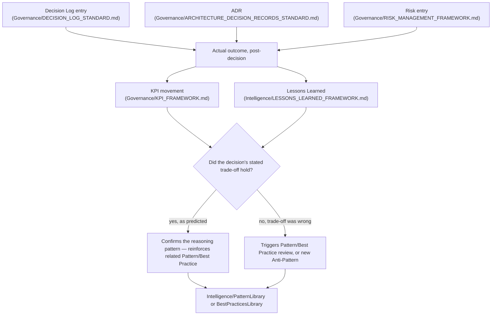

# Decision Intelligence

> Connects `Governance/DECISION_LOG_STANDARD.md` entries, `Governance/ARCHITECTURE_DECISION_RECORDS_STANDARD.md` entries, `Governance/RISK_MANAGEMENT_FRAMEWORK.md` risk records, and real outcomes/metrics into a single queryable web — so a future Agent facing a new decision can ask "has something like this been decided before, and how did it actually turn out" and get a real answer, not just a pile of unconnected historical documents.

Governed by `Core/DECISION_FRAMEWORK.md` (the reasoning method), `Governance/DECISION_LOG_STANDARD.md` and `Governance/ARCHITECTURE_DECISION_RECORDS_STANDARD.md` (the record formats this document links together), `Intelligence/ORGANIZATIONAL_MEMORY.md` (the retrieval architecture this is an instance of).

## The Gap This Closes

`Governance/DECISION_LOG_STANDARD.md` and `Governance/ARCHITECTURE_DECISION_RECORDS_STANDARD.md` are excellent at capturing a single decision well. Neither, by design, tracks whether the decision's stated Review Cadence / Revisit Trigger was actually acted on, or whether the decision's predicted trade-off actually matched reality once outcomes and KPIs came in. Without this connective layer, a decision record is a snapshot of reasoning at the time — valuable, but not learning. Decision Intelligence is what turns a pile of DEC/ADR records into a track record: which kinds of decisions this organization gets right, which kinds it consistently gets wrong, and why.

## The Decision Intelligence Graph



A decision record that's written and never revisited against real outcomes is only half of Decision Intelligence — the other half, and the one most organizations skip, is closing the loop back to whether the reasoning was actually right.

## How Historical Decisions Are Indexed

Every `Governance/Decisions/DEC-###` and `Knowledge/*/ADR/ADR-####` entry is tagged, at creation, with:

```yaml
decision_type: <e.g., "scope-cut", "vendor-choice", "architecture-pattern", "pricing", "risk-acceptance">
domain: <Department/Knowledge domain>
reasoning_pattern: <which Core/DECISION_FRAMEWORK.md priority dominated — e.g., "Maintainability over Velocity">
review_due: YYYY-MM-DD (from the entry's stated Review Cadence / Revisit Trigger)
outcome_status: pending | confirmed | contradicted | mixed
```

`decision_type` and `reasoning_pattern` are the two fields that make this genuinely queryable — a future Agent facing a new "scope-cut under deadline pressure" decision can retrieve every prior decision tagged that way, regardless of which project or Department it came from, and see the `outcome_status` distribution.

## Outcome Tracking

At each decision's `review_due` date (enforced at Quarterly Business Review per `Governance/MEETING_OPERATING_SYSTEM.md`), the Chief of Staff closes the loop:

1. Pull the KPI(s) relevant to the decision's stated goal (`Governance/KPI_FRAMEWORK.md`).
2. Compare actual movement against the decision's stated expected impact (from its Impact Analysis / Consequences section).
3. Set `outcome_status`:
   - **confirmed** — the predicted trade-off held; the reasoning pattern is reinforced.
   - **contradicted** — reality diverged meaningfully from the prediction; triggers a `Intelligence/LESSONS_LEARNED_FRAMEWORK.md` review specifically on the reasoning gap, not just the surface outcome.
   - **mixed** — partially held; noted with specifics, not forced into a binary.
   - **pending** — review date not yet reached, or insufficient data (state why).
4. Update the linked Pattern/Best Practice/Anti-Pattern entry in `Intelligence/PatternLibrary/` or `Intelligence/BestPracticesLibrary/` with this evidence — a confirmed decision reinforces its underlying pattern's Evidence table; a contradicted one either weakens that pattern's approval status (flagged for Chief of Staff review) or spawns a new Anti-Pattern entry.

## Decision Intelligence Query Log

Stored at `Intelligence/DecisionIntelligence/index.md`, a living cross-reference table rather than prose — this is the practical retrieval surface:

```markdown
| DEC/ADR ID | Decision Type | Domain | Reasoning Pattern | Review Due | Outcome Status | Linked Pattern |
|---|---|---|---|---|---|---|
| DEC-009 | scope-cut | Product | Velocity over Polish | 2026-10-01 | confirmed | Intelligence/PatternLibrary/Product/deadline-driven-scope-cut.md |
| ADR-0031 | architecture-pattern | Engineering | Maintainability over Velocity | 2027-01-10 | pending | — |
| DEC-014 | vendor-choice | Business | Business Value over Cost | 2026-08-15 | contradicted | Intelligence/PatternLibrary/Business/anti-patterns/vendor-lock-in-underestimated.md |
```

This index is what a CEO or any Agent actually queries before making a new decision of a similar type — filtered by `decision_type` and/or `domain`, sorted by `outcome_status` to see the track record at a glance.

## How Future Agents Should Use Historical Decisions

1. **Before a significant decision, query the index** for matching `decision_type` and `domain` (or `reasoning_pattern` if the type doesn't match but the underlying trade-off logic does). This is an explicit step in the CEO's decision workflow (`Executive/CEO/CEO_AGENT.md`) and any Agent's application of `Core/DECISION_FRAMEWORK.md`.
2. **A `confirmed` track record for this decision type is evidence, not proof** — cite it in the new decision's Alternatives Considered / Technical Rationale section (per `Governance/DECISION_LOG_STANDARD.md` / `Governance/ARCHITECTURE_DECISION_RECORDS_STANDARD.md`), but the new decision still names its own context-specific reasoning; history informs, it doesn't replace judgment (`Core/DECISION_FRAMEWORK.md` is a method, not an autopilot, same principle as `Governance/KPI_FRAMEWORK.md`'s anti-pattern rule).
3. **A `contradicted` track record is a yellow flag, not a veto** — it means the reasoning pattern has failed before under similar conditions; the new decision must explicitly address why this instance is different, or choose differently.
4. **If no matching decision exists in the index, that's itself useful information** — it means this is a genuinely novel decision type for the organization, and extra rigor (full Alternatives Considered, more conservative Review Cadence) is warranted precisely because there's no track record yet.

## Review Cadence Enforcement

This is Decision Intelligence's single most important operational function: `Governance/DECISION_LOG_STANDARD.md` and `Governance/ARCHITECTURE_DECISION_RECORDS_STANDARD.md` both require a stated review trigger, but neither, alone, guarantees it's acted on. The Decision Intelligence index is the tracking mechanism — at every Quarterly Business Review, the Chief of Staff runs a report: every entry with `review_due` in the past quarter and `outcome_status: pending` is a compliance gap, escalated the same way an overdue `Governance/CONTINUOUS_IMPROVEMENT_SYSTEM.md` Follow-Through item is.

## Anti-Patterns

- **Write-only decision records.** DEC/ADR entries created and never revisited — the single failure mode this entire document exists to prevent. Caught by the Quarterly review-due report.
- **Treating history as destiny.** Using a `confirmed` track record to skip stating fresh Alternatives Considered for a new decision — history is an input to `Core/DECISION_FRAMEWORK.md`, not a substitute for it.
- **Vague `decision_type` tagging.** Tags too broad ("general") or too narrow (one-off, never reusable) both break queryability — reviewed at Chief of Staff's Governance audit for consistency with existing tag usage.
- **Ignoring `contradicted` outcomes.** Letting a pattern with a documented contradiction keep being cited as if unblemished — the linked Pattern/Best Practice entry must reflect the contradiction, not just the earlier confirmations.

## Metadata

```yaml
version: 1.0.0
status: active
last_reviewed: 2026-07-22
owner: Chief of Staff (index stewardship + review-cadence enforcement), CEO (consumes for roadmap decisions)
```
