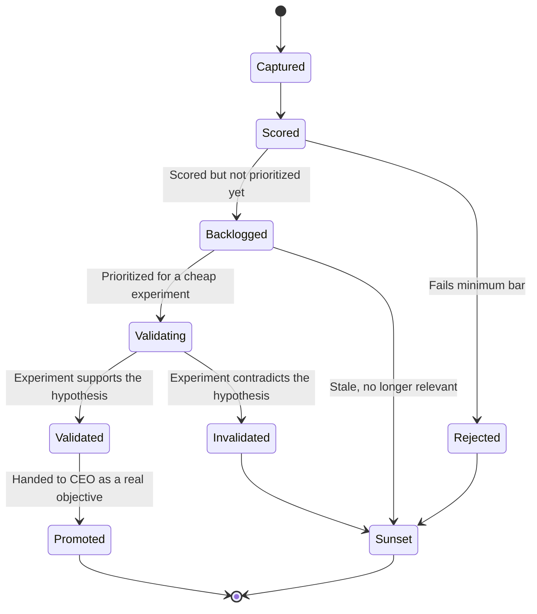
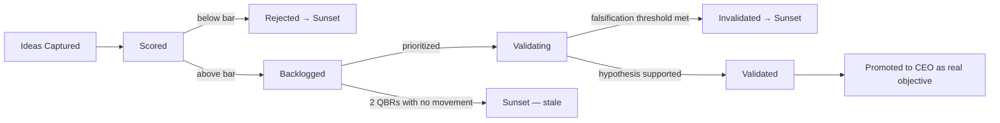

# Innovation Lab

> Where new ideas — from any Agent, Department, or the human principal — are captured, scored, tested cheaply, and either promoted into the real roadmap or deliberately sunset. Without a structured intake, ideas either get built impulsively (bypassing `Core/QUALITY_STANDARD.md`'s Business Value gate) or get lost in conversation and never revisited. The Innovation Lab is the controlled space between "someone had a thought" and "the CEO delegates it as a real objective."

Governed by `Core/DECISION_FRAMEWORK.md` (scoring an opportunity is a decision like any other), `Core/AI_OS_CONSTITUTION.md` §7 (YAGNI — the Lab is precisely where a "might need it later" idea goes instead of being built prematurely).

## Why This Sits Outside the Normal Pipeline

`Core/WORKFLOW_STANDARD.md`'s pipeline (Research → Architecture → ... → Analytics) is built for objectives the CEO has already decided to pursue. An idea in the Innovation Lab has not cleared that bar yet — sending every raw idea through the full pipeline would either bottleneck real work or (worse) quietly skip the pipeline's rigor "just to try something." The Lab is a lightweight, separate lane specifically for validating whether an idea deserves the full pipeline at all.

## The Innovation Lifecycle



## Capturing an Idea

Any Agent, Department, or the human principal can submit an idea — low friction on purpose, since the scoring step (not the intake step) is where rigor is applied.

```markdown
# Idea: <name>

## Submitted By
<Agent/Department/human>

## Date
YYYY-MM-DD

## The Idea
What it is, in plain language — one paragraph.

## Problem It Solves
The user or business problem this addresses — if this can't be stated, the idea isn't ready to score yet (send back to the submitter, don't score a solution with no named problem).

## Initial Hypothesis
What we believe will happen if we build/try this, stated so it's falsifiable — "users will X" or "this will reduce Y by Z," not an unfalsifiable "this will be better."

## Status
Captured
```

## Scoring Opportunities

Every Captured idea is scored before it's allowed into the Backlog — this is the gate that keeps the Lab from becoming an unfiltered wish list.

| Dimension | Score 1-5 | Guidance |
|---|---|---|
| Problem validity | | Is there real evidence this problem exists (Analytics, Research Library, direct client feedback), or is it speculative? |
| Strategic fit | | Does this align with `Core/AI_OS_CONSTITUTION.md`'s Vision/Mission and the current roadmap direction? |
| Effort to validate cheaply | | Can a cheap experiment (not a full build) test the hypothesis? Lower effort scores higher. |
| Potential impact | | If validated and built, how much business/user value per `Governance/KPI_FRAMEWORK.md`? |
| Reversibility of the experiment | | Can the validation step be undone/abandoned cheaply if it doesn't pan out? |

**Opportunity Score = sum of the five dimensions (range 5-25).** This deliberately mirrors the structure of `Governance/RISK_MANAGEMENT_FRAMEWORK.md`'s Likelihood × Impact scoring — the organization already has one calibrated scoring instinct from risk management; reusing a similar shape for opportunity scoring keeps the mental model consistent rather than introducing a third distinct scoring system.

| Score | Tier | Action |
|---|---|---|
| 5-11 | Low priority | Backlogged, revisited opportunistically or at Quarterly Business Review |
| 12-18 | Moderate priority | Backlogged, considered for the next available cheap-experiment slot |
| 19-25 | High priority | Fast-tracked into Validating within the current cycle |

A score below 10 with Problem Validity below 2 is auto-Rejected rather than Backlogged — an idea with no real evidence of a problem is not worth holding onto indefinitely; it can always be resubmitted later if evidence emerges (per `Intelligence/RESEARCH_LIBRARY_STANDARD.md` or `Departments/Analytics` findings).

## Experiment Backlog

Backlogged ideas above the minimum bar sit in a prioritized list, re-ordered at each Monthly Business Review (`Governance/MEETING_OPERATING_SYSTEM.md`) using the same score, adjusted for anything that's changed (new evidence, a shifted strategic priority).

```markdown
## Experiment Backlog

| Idea | Opportunity Score | Problem Validity | Priority Tier | Status |
|---|---|---|---|---|
| | | | | Backlogged / Validating |
```

## Validation Process

A cheap experiment — never the full `Core/WORKFLOW_STANDARD.md` pipeline — designed specifically to test the Initial Hypothesis with the least effort that produces a real signal:

1. **Design the smallest test that could falsify the hypothesis** — a landing page and waitlist instead of a built feature; a manual/concierge version instead of automated; a prototype shown to 5 real users instead of a full design cycle.
2. **Define the falsification threshold up front** — what result would count as "invalidated," stated before running the experiment, not decided after seeing results (this is what keeps validation honest rather than motivated reasoning).
3. **Run it, time-boxed** — a validation experiment has a stated end date; it does not run indefinitely.
4. **Record the result against the threshold**, not against hoped-for outcomes.

```markdown
## Validation Record

## Experiment Design
The smallest test run and why it's sufficient to address the hypothesis.

## Falsification Threshold (set before running)
The specific result that would count as "this hypothesis is wrong."

## Result
What actually happened, measured.

## Verdict
Validated | Invalidated | Inconclusive (if inconclusive, state what a real test would need — inconclusive is not a third permanent state, it routes back to redesigning the experiment)
```

## Promotion to Real Roadmap

A Validated idea is handed to the CEO exactly like any new objective (`Executive/CEO/CEO_AGENT.md`) — the Innovation Lab's job ends at "this is worth building," not at building it. The CEO applies its normal Objective-Decomposition Pattern from there; the Lab's validation record becomes the Research-stage input, often letting that stage move faster since the core hypothesis is already evidenced.

## Sunset Process

An idea is Sunset — not silently deleted, per `Core/KNOWLEDGE_STANDARD.md`'s retirement rules — when:

- It's Rejected at scoring (no real problem evidence).
- It's Invalidated by experiment.
- It's been Backlogged for more than 2 Quarterly Business Reviews with no priority movement (stale — the organization's priorities have evidently moved on).

A Sunset entry stays archived with its full record — an Invalidated idea is genuinely useful organizational memory (an Anti-Pattern candidate in `Intelligence/PATTERN_LIBRARY_STANDARD.md` if the invalidation reveals a recurring flawed assumption), not wasted effort to discard.

## Innovation Funnel Overview



## Anti-Patterns

- **Building before validating.** Skipping straight from Captured to a full build because an idea feels obviously good — the entire point of this system is that "obviously good" ideas fail validation often enough to be worth the cheap check first.
- **Moving the falsification threshold after seeing results.** Set before the experiment runs; changed only via a new, explicitly logged experiment design, never retroactively.
- **Infinite Backlog residence.** An idea sitting Backlogged for years with no re-scoring — the 2-QBR staleness rule exists specifically to force a Sunset-or-reprioritize decision.
- **Treating Invalidated as failure to hide.** An Invalidated experiment with a clear falsification threshold is a successful use of the system — cheap learning, not wasted effort — and is recorded with the same rigor as a Validated one.

## Metadata

```yaml
version: 1.0.0
status: active
last_reviewed: 2026-07-22
owner: Product (scoring + validation stewardship), CEO (promotion decisions)
```
