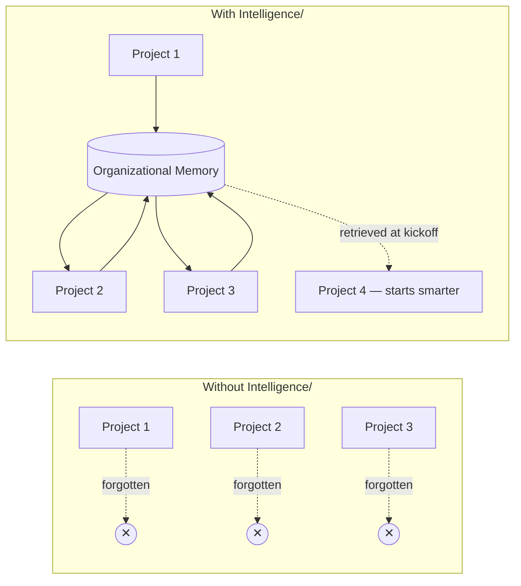
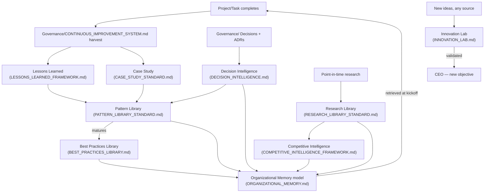
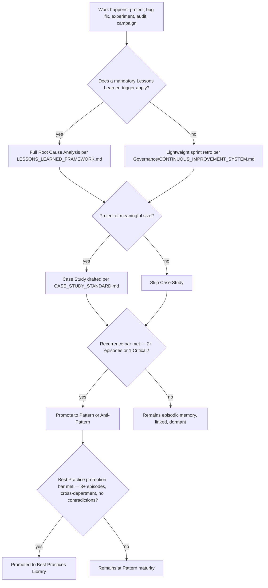
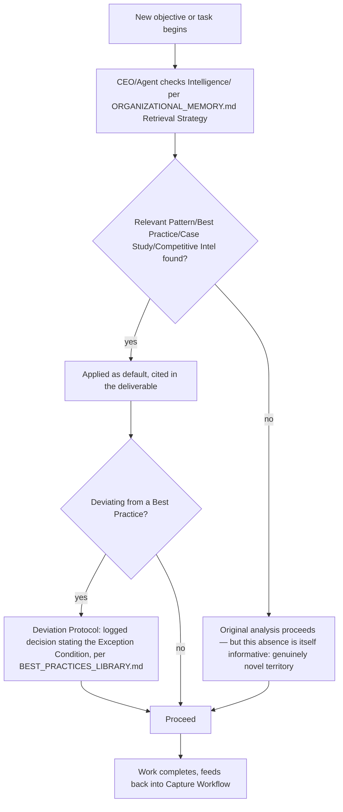

# Intelligence Playbook

> The narrative reference for how the `Intelligence/` layer actually works day to day: how every Department contributes to and draws from shared organizational learning, the concrete workflows for capturing and applying knowledge, and how this layer connects to Core, Executive, Governance, and every future Department and Agent. Read this after the other nine `Intelligence/` documents — it assumes each of them and shows how they operate together as one system.

Governed by `Core/AI_OS_CONSTITUTION.md` §4 (Long-Term Philosophy).

## Why This Layer Exists, in One Picture



Every other layer in this OS (`Core/`, `Executive/`, `Governance/`) governs how work gets *done correctly*. `Intelligence/` is the only layer whose entire purpose is making sure the organization is measurably better at doing that work **the next time**, and the time after that. Without it, `Core/`'s Constitution claim that "compounding knowledge is the actual product" is just an aspiration; `Intelligence/` is the concrete machinery that makes it literally true.

## The Nine Components, How They Relate



`Intelligence/ORGANIZATIONAL_MEMORY.md` is the architectural spine — it's not a ninth parallel component but the model the other eight all plug into (episodic vs. semantic memory, lifecycle, retrieval strategy). Everything else is a specific instance of capturing or retrieving against that model.

## How Every Department Contributes

Every Department's involvement in `Intelligence/` is not optional overhead bolted onto its real work — it is one of the required outputs of that work, already established structurally in `Governance/CONTINUOUS_IMPROVEMENT_SYSTEM.md`'s 8 harvest outputs. This playbook just makes explicit which `Intelligence/` document each Department feeds most:

| Department | Primarily feeds | Example contribution |
|---|---|---|
| Engineering | Pattern Library (technical), Decision Intelligence (ADRs) | The idempotent webhook handler pattern |
| Design | Pattern Library, Best Practices Library | Design system component adoption defaults |
| Product | Innovation Lab, Case Study Standard, Competitive Intelligence | Feature validation experiments, adoption case studies |
| QA | Lessons Learned Framework, Best Practices Library | Regression-test-per-escaped-bug default |
| SEO | Pattern Library, Best Practices Library | Canonical tag defaults, algorithm-update response patterns |
| Marketing | Case Study Standard, Competitive Intelligence, Research Library | Campaign case studies, positioning research |
| Analytics | Decision Intelligence (outcome tracking), Organizational Memory retrieval instrumentation | Closing the loop on whether a decision's predicted KPI impact held |
| Business | Competitive Intelligence, Research Library (market), Decision Intelligence | Pricing history, market reports |

Every Department both **contributes** (writes new episodic/semantic memory from its work) and **consumes** (retrieves existing intelligence before starting new work) — a Department that only contributes and never checks existing intelligence before acting is violating the reuse-check flowchart already established in `Core/KNOWLEDGE_STANDARD.md` and reinforced by `Intelligence/ORGANIZATIONAL_MEMORY.md`'s Retrieval Strategy.

## The Capture Workflow (End to End)



This is the literal answer to the "Redis cache invalidation bug" example: the bug fix triggers this workflow, not a shrug. Whether it results in a Pattern, a Best Practice, or stays a single linked Lessons Learned entry depends on where it actually lands on the recurrence/impact bar — not every bug produces an organization-wide standard change, but every bug is *run through the check*.

## The Application Workflow (End to End)



## Governance of This Layer Itself

`Intelligence/` is not exempt from the rules it draws on:

- Every document here follows `Governance/DOCUMENT_LIFECYCLE.md`'s five states.
- Promotion bars (Pattern → Best Practice, Captured → Validated in the Innovation Lab) are enforced at review, not left to author discretion, per each document's own rules.
- The Chief of Staff audits `Intelligence/` health at the Monthly Business Review exactly as it audits `Knowledge/`/`Memory/` under `Governance/KNOWLEDGE_GOVERNANCE.md` — staleness sweeps, ownership checks, retrieval-compliance spot checks.
- Amendments to any `Intelligence/` standard follow `Core/AI_OS_CONSTITUTION.md` §12, ratified at Quarterly Business Review or Annual Strategic Review per `Governance/MEETING_OPERATING_SYSTEM.md`.

## Scaling to Decades of Growth

The reason this layer is designed the way it is — strict promotion bars, tiered competitor tracking, shelf-life-aware research, a single architectural memory model — is that none of its mechanisms get more expensive as the organization grows from 8 Departments to 100, or from a handful of completed projects to thousands:

- **Retrieval scales because it's targeted, not exhaustive.** An Agent checks its specific domain's Pattern/Best Practice entries, not the entire accumulated history of the organization.
- **Promotion bars prevent library bloat.** Without the 2+/3+ episode bars, a thousand-project organization would have thousands of "patterns," most single-use and unreliable — the bars keep the semantic-memory layer small, curated, and trustworthy even as episodic memory (which can grow large; that's fine, it's less frequently browsed wholesale) grows without bound.
- **Tiering (Innovation Lab priority, Competitive Intelligence tiers) prevents equal-intensity tracking of everything**, which is what actually breaks these systems at scale in real organizations.
- **The Decision Intelligence index is designed to be queried by tag, not read linearly** — a thousand-entry index is exactly as usable as a ten-entry one for the actual use case (find matching `decision_type`/`domain`).

## The One-Sentence Summary

**Core defines what an Agent is; Governance defines how the company runs itself; Intelligence is what makes the company that ran a thousand projects meaningfully smarter than the company that ran its first one — turning every completed project, bug fix, experiment, and audit into a compounding asset instead of a forgotten event.**

## Metadata

```yaml
version: 1.0.0
status: active
last_reviewed: 2026-07-22
owner: Chief of Staff (stewardship), CEO (ratification authority), every Department (contribution + consumption)
```
