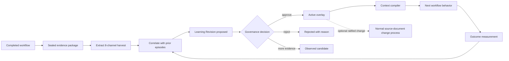
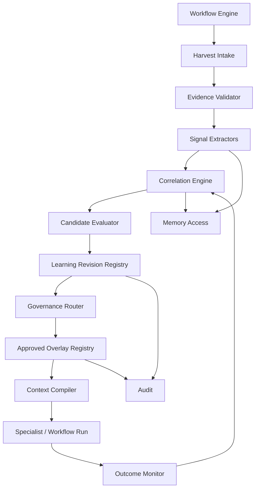
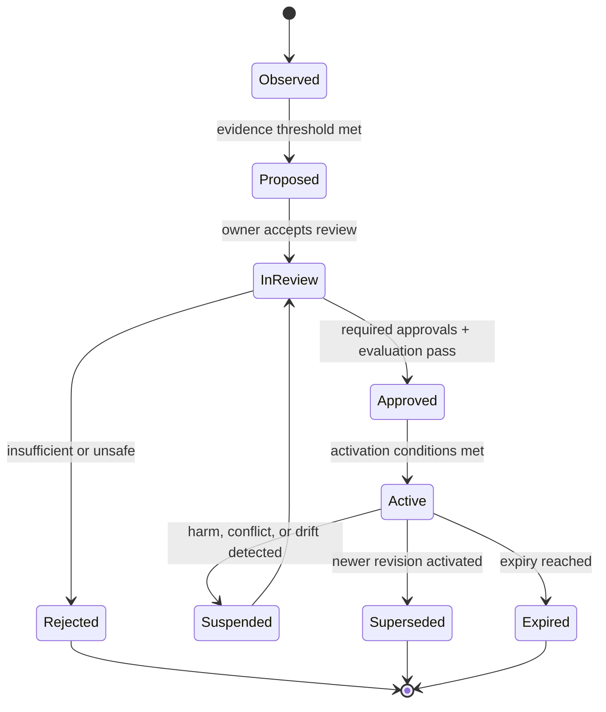
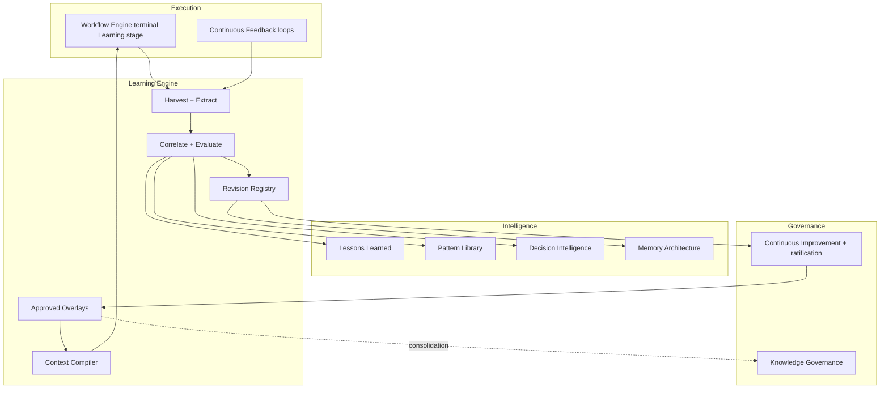

# Learning Engine Architecture

> Converts every completed workflow into evidence-backed learning and makes approved
> improvements available to future workflows without allowing an automated process to
> rewrite canonical playbooks, specialist specifications, prompts, standards, or
> architecture documents directly.

Governed by `Governance/CONTINUOUS_IMPROVEMENT_SYSTEM.md`,
`Governance/KNOWLEDGE_GOVERNANCE.md`, and
`Intelligence/ORGANIZATIONAL_MEMORY.md`.
Consumes the terminal Learning stage defined by `Execution/WORKFLOW_ENGINE.md` and
`Execution/CONTINUOUS_FEEDBACK.md`.
Uses `Intelligence/MEMORY_ARCHITECTURE.md` and
`Runtime/Domains/Memory_Access_Runtime.md` for durable memory.

**No implementation in this document** — architecture and contracts only.

---

## 1. Positioning

The Learning Engine is the controlled bridge between workflow outcomes and improved
future behavior. It extracts signals, finds recurrence, proposes improvements, routes
them through governance, and exposes approved changes as runtime overlays.

It is not:

- a second Workflow Engine;
- a second Event Bus;
- a second memory system;
- an autonomous editor of repository source documents;
- an authority that bypasses Department, Chief of Staff, or CEO ratification.

| Layer | Existing owner | Learning Engine responsibility |
| --- | --- | --- |
| Workflow completion | Execution | Receive a sealed completion evidence package |
| Learning policy | Intelligence | Extract, correlate, rank, and package learning |
| Durable memory | Organizational / Specialist Memory | Store episodes and promotion references |
| Ratification | Governance | Review, approve, reject, supersede, or expire proposals |
| Runtime application | Context assembly / specialist runtime | Merge approved overlays with canonical sources |
| Source document changes | Owning Department / Governance | Apply approved proposals through normal versioned change control |

**Noun rule.** A **Learning Revision** is an immutable, evidence-backed proposal or
approved overlay. It is not a direct mutation of the artifact it improves.

---

## 2. Goals

Every completed workflow produces an explicit result for all eight learning channels:

1. Lessons Learned
2. Patterns
3. Common Failures
4. Successful Decisions
5. Prompt Improvements
6. Architecture Improvements
7. Repeated Bugs
8. Repeated User Requests

The engine then makes approved learning available to:

- playbooks;
- specialist knowledge;
- memory;
- decision rules;

without modifying their canonical source documents directly.

The system must be:

| Property | Meaning |
| --- | --- |
| Complete | Every terminal workflow emits a harvest, including explicit `no_signal` results |
| Evidence-backed | Every claim points to runs, artifacts, decisions, outcomes, and metrics |
| Append-only | Learning records are revised or superseded, never silently rewritten |
| Idempotent | Duplicate completion events do not create duplicate lessons |
| Governed | Activation authority depends on target and risk |
| Reversible | An overlay can be disabled without reverting a source document |
| Scoped | Tenant, project, Department, specialist, and global learning cannot leak |
| Measurable | The next relevant workflow records whether applied learning helped |

---

## 3. Core Principle: Propose, Approve, Overlay, Measure



The engine never opens and edits a target playbook, specialist specification, prompt,
decision framework, or architecture file. It writes a separate Learning Revision.
Approved revisions are resolved at runtime alongside the canonical source. If permanent
source consolidation is desirable, the revision becomes input to the existing
Department/Governance document lifecycle; that is a separate, attributable action.

---

## 4. High-Level Components



### 4.1 Harvest Intake

Consumes terminal workflow facts and creates exactly one harvest job per workflow
instance and completion revision. It accepts normal completion, meaningful abandonment,
and unrecovered failure. Rejected-at-scoping requests do not require a full harvest.

### 4.2 Evidence Validator

Rejects or quarantines harvests whose evidence is incomplete, unsealed, out of scope, or
not traceable to the workflow. Extraction does not begin until minimum provenance is
present.

### 4.3 Signal Extractors

Eight independent extractors produce typed observations. An extractor may return:

- `candidate` — supported learning was found;
- `evidence_only` — adds evidence to an existing candidate;
- `no_signal` — checked and found nothing material;
- `insufficient_evidence` — potentially material, but cannot yet support a claim.

### 4.4 Correlation Engine

Matches new observations against prior episodes using structured identity first,
lexical/semantic similarity second. It detects recurrence without equating similarity
with sameness.

### 4.5 Candidate Evaluator

Scores evidence quality, recurrence, impact, confidence, scope, contradiction, and
expected benefit. It recommends observation, review, or expedited review; it does not
grant authority to activate high-impact changes.

### 4.6 Learning Revision Registry

The append-only source of record for proposed, approved, rejected, superseded, and
expired Learning Revisions. It stores references to evidence, never mutable copies of
canonical documents.

### 4.7 Governance Router

Selects reviewers from the target, scope, and risk class. It reuses the ratification
model in `Governance/CONTINUOUS_IMPROVEMENT_SYSTEM.md`; it does not create a parallel
approval path.

### 4.8 Approved Overlay Registry

Contains only currently approved revisions and indexes them by target, scope,
applicability predicates, priority, and compatibility. It is a projection of the
Learning Revision Registry, not a separate authority.

### 4.9 Context Compiler

Builds the effective instructions for a run:

```text
canonical source
  + approved global overlays
  + approved Department overlays
  + approved specialist/workflow overlays
  + project/tenant overlays allowed by scope
  + relevant cited memory
  = effective runtime context
```

The compiler records the exact source versions and overlay IDs in a Context Manifest so
the run is reproducible.

### 4.10 Outcome Monitor

Connects applied overlays to downstream outcomes. It can reinforce, weaken, suspend, or
request review of a revision, but suspension and activation follow the authority rules in
§11.

---

## 5. Completion Evidence Package

The Workflow Engine seals a package before publishing completion:

```yaml
kind: workflow_learning_evidence
schemaVersion: "1.0.0"
evidenceId: wle_...
workflowInstanceId: EXEC-###
workflowType: bug-fix
completionRevision: 1
terminalState: learning_complete
projectId: project_...
tenantId: tenant_...

objective:
  requestRefs: []
  acceptanceCriteriaRefs: []
  expectedOutcomeRefs: []

execution:
  stageHistoryRef: artifact://...
  specialistRunIds: []
  artifactIds: []
  decisionIds: []
  promptManifestIds: []
  contextManifestIds: []

outcome:
  verdict: pass
  kpiBaselineRefs: []
  kpiActualRefs: []
  gateResults: []
  incidents: []
  bugs: []
  userFeedbackRefs: []

provenance:
  rootEventId: evt_...
  correlationId: corr_...
  sealedAt: 2026-07-25T00:00:00Z
  contentHash: sha256:...
```

Minimum evidence is the original request, workflow type, stage history, terminal verdict,
produced artifacts, decisions, and a measurable outcome or an explicit statement that the
outcome is not yet observable.

Late-arriving monitoring evidence creates a new `completionRevision`; it does not rewrite
the original package.

---

## 6. The Eight Learning Channels

| Channel | Extracted signal | Correlation key | Typical destination |
| --- | --- | --- | --- |
| Lessons Learned | Root cause, consequence, and traceable corrective proposal | root-cause class + affected control | Episodic memory; lesson review |
| Patterns | Reusable problem/context/solution with evidence | domain + problem + context constraints | Pattern Library candidate |
| Common Failures | Recurring failure mode across workflows, specialists, or gates | normalized failure signature | Anti-pattern; playbook/knowledge overlay |
| Successful Decisions | Decision whose predicted trade-off matched measured outcome | decision type + reasoning pattern + context | Decision Intelligence; decision-rule overlay |
| Prompt Improvements | Prompt behavior linked to avoidable ambiguity, retries, omissions, or strong outcomes | prompt ID/version + failure/success class | Prompt overlay |
| Architecture Improvements | Structural constraint or design change supported by outcome evidence | subsystem + quality attribute + trade-off | Architecture proposal; playbook overlay |
| Repeated Bugs | Same underlying defect class, not merely the same symptom | component + root cause + invariant violated | Known-bug memory; prevention-rule overlay |
| Repeated User Requests | Semantically equivalent demand recurring across users/projects | intent + actor + context + desired outcome | Product/request pattern; prioritization input |

### 6.1 Lessons Learned

Uses `Intelligence/LESSONS_LEARNED_FRAMEWORK.md`. Full RCA is required for its mandatory
triggers. A lesson is not actionable until it identifies a target and a proposed change,
or explicitly states why existing policy was already sufficient.

### 6.2 Patterns

Uses `Intelligence/PATTERN_LIBRARY_STANDARD.md`. One occurrence remains episodic unless
Critical impact justifies immediate review. Two distinct episodes permit promotion
review; they do not guarantee approval.

### 6.3 Common Failures

Aggregates failure signatures across gate results, rework loops, incidents, negative
specialist verdicts, and abandoned work. It distinguishes:

- symptom recurrence;
- shared root-cause recurrence;
- enforcement failure of an existing rule;
- missing rule or missing knowledge.

Only the last two justify behavioral updates, and their remedies differ: enforcement
failures route to compliance/training, missing rules route to a proposed rule.

### 6.4 Successful Decisions

Uses `Intelligence/DECISION_INTELLIGENCE.md`. A decision is successful when its stated
objective and predicted trade-offs are confirmed by observed outcomes, not merely when
the workflow finished. Confirmed decisions add evidence to a reasoning pattern; they do
not become universal rules without context boundaries.

### 6.5 Prompt Improvements

Compares prompt version, supplied context, tool path, retries, reviewer findings, and
outcome. It may propose clearer instructions, missing context retrieval, tighter output
constraints, examples or counterexamples, safer escalation conditions, or removal of
instructions associated with degraded outcomes.

Model output alone is not evidence that a prompt is better. Activation requires an
evaluation result or a controlled canary appropriate to the risk.

### 6.6 Architecture Improvements

Produces an architecture change proposal with affected quality attributes, alternatives,
trade-offs, migration implications, and links to relevant ADRs. It never edits an ADR or
architecture source. Material structural changes follow the ADR and ratification path.

### 6.7 Repeated Bugs

Uses a normalized fingerprint:

```text
bug fingerprint =
  affected component
  + violated invariant
  + root-cause category
  + trigger conditions
```

Stack traces and issue titles are supporting evidence, not identity. A second confirmed
episode raises a prevention candidate; a High/Critical first occurrence can raise one
immediately.

### 6.8 Repeated User Requests

Clusters by user intent rather than wording. The engine preserves actor, tenant, use
case, frequency, recency, and business impact. Repetition is prioritization evidence, not
automatic roadmap authority. Cross-tenant aggregation must be anonymized and
policy-permitted.

---

## 7. Learning Observation Contract

Every extractor emits an observation:

```yaml
kind: learning_observation
schemaVersion: "1.0.0"
observationId: lob_...
channel: repeated_bug
status: candidate

claim:
  title: "Tenant cache keys omit tenant identity"
  summary: "The same invariant violation caused two distinct regressions."
  normalizedKey: "cache-key|tenant-isolation|missing-tenant-id"
  scope:
    level: department
    department: Engineering
    specialistIds: [engineering, qa]

evidence:
  episodeRefs: [wle_001, wle_019]
  artifactRefs: []
  decisionRefs: []
  metricRefs: []
  counterEvidenceRefs: []

assessment:
  recurrenceCount: 2
  distinctContextCount: 2
  impact: high
  confidence: 0.91
  evidenceQuality: strong

proposedTargets:
  - targetKind: decision_rule
    targetId: engineering.cache-design
  - targetKind: specialist_knowledge
    targetId: engineering.known-bugs
```

Observations are immutable. Corrections produce a superseding observation with a reason.

---

## 8. Correlation and Promotion

### 8.1 Matching order

1. Exact stable identifiers: workflow, bug, decision, prompt, target.
2. Structured fingerprint: domain, root cause, invariant, request intent, context.
3. Lexical and semantic retrieval from relevant scoped memory.
4. Candidate merge recommendation.
5. Human confirmation when a merge affects recurrence or promotion eligibility.

Semantic similarity alone cannot promote a candidate.

### 8.2 Promotion policy

| Condition | Default treatment |
| --- | --- |
| First Low/Medium occurrence | Record episodically; observe |
| Second distinct occurrence | Propose systemic review |
| First High/Critical occurrence | Propose expedited review |
| Contradictory evidence | Hold or lower confidence; require review |
| Existing approved learning applies | Add evidence; do not fork |
| Existing rule was ignored | Propose enforcement/training, not a duplicate rule |

This mirrors the triage rule in `Governance/CONTINUOUS_IMPROVEMENT_SYSTEM.md`; the engine
enforces it mechanically rather than reinventing it.

### 8.3 Confidence is not authority

A high model confidence score can prioritize review but cannot approve an overlay.
Authority comes from provenance, evidence, evaluation, ownership, and ratification.

---

## 9. Learning Revision Contract

```yaml
kind: learning_revision
schemaVersion: "1.0.0"
revisionId: lrv_...
revision: 1
status: proposed
changeType: add

target:
  kind: decision_rule
  id: engineering.cache-design
  canonicalSourceRef: Core/DECISION_FRAMEWORK.md
  baseVersion: "1.0.0"
  baseContentHash: sha256:...
  selector: "domain=cache and tenancy=multi-tenant"

proposal:
  operation: append_contextual_rule
  contentRef: content://...
  summary: "Require tenant identity in every cache-key design."
  rationale: "Prevents a repeated cross-tenant cache defect."

evidence:
  observationIds: [lob_...]
  episodeRefs: [wle_001, wle_019]
  evaluationRefs: [eval_...]

applicability:
  tenantIds: []
  projectIds: []
  departments: [Engineering]
  specialistIds: [engineering, qa]
  workflowTypes: [feature-delivery, bug-fix]
  effectiveFrom: 2026-08-01T00:00:00Z
  expiresAt: null

governance:
  riskClass: medium
  owner: Engineering
  requiredApprovers: [engineering-lead]
  approvals: []

lineage:
  supersedes: null
  rootEventId: evt_...
  createdAt: 2026-07-25T00:00:00Z
  createdBy: learning-engine
```

Rules:

- The target source reference and hash are used for compatibility checks, not mutation.
- Content is declarative and scoped; arbitrary executable code is forbidden.
- Every revision has evidence, an owner, a review policy, and rollback semantics.
- An update creates a new revision and supersedes the old one.
- Rejection includes a reason and remains auditable.

---

## 10. Target Adapters

The engine has one logical adapter per target kind. Adapters validate overlay shape and
compile it into runtime context; they do not edit source files.

### 10.1 Playbook Overlay

Can add or refine stage guidance, checklists, failure warnings, handoff conditions, and
evidence-backed examples. It cannot reorder canonical workflow stages or remove required
gates without the ratification required for the underlying workflow source.

### 10.2 Specialist Knowledge Overlay

Adds scoped facts, known risks, patterns, examples, and retrieval hints to the
specialist's effective knowledge bundle. Durable facts still write through Memory Access
and retain citations.

### 10.3 Memory Update

Memory is the only target with an existing writeback mechanism. The Learning Engine
submits validated `MemoryDelta` records through Memory Access per
`Intelligence/MEMORY_ARCHITECTURE.md`; it never writes another specialist's store
directly. Organizational promotion uses `memory.harvest.proposed`.

### 10.4 Decision Rule Overlay

Adds a contextual rule containing a condition, recommended action, rationale, exceptions,
confidence with evidence, and an escalation path. It cannot silently override
constitutional, security, trust, approval, or quality-gate rules. Conflicts resolve in
favor of the higher-authority canonical rule.

### 10.5 Prompt Overlay

Targets a stable prompt ID and compatible base version. It supports instruction blocks,
examples, constraints, and retrieval directives. The prompt manifest records the exact
composition and experiment cohort.

### 10.6 Architecture Proposal

Architecture improvements remain proposals until the owning authority ratifies an ADR or
source change. A low-risk operational warning may surface as a playbook overlay, but
structural architecture is never changed through context composition alone.

---

## 11. Governance and Activation

### 11.1 State model



### 11.2 Approval matrix

| Target / scope | Required authority |
| --- | --- |
| Specialist memory in owned categories | Specialist writeback policy + Memory Access validation |
| Department knowledge/playbook overlay | Owning Department |
| Specialist prompt or decision-rule overlay | Owning Department; Chief of Staff review if cross-specialist |
| Project-specific workflow guidance | Project Manager + owning Department |
| Cross-Department workflow overlay | Chief of Staff + affected Departments |
| Core, Governance, constitutional, or system-wide rule | CEO under existing amendment process |
| Architecture structure or security/trust boundary | Owning architecture authority and applicable ADR/security review |

### 11.3 Emergency suspension

Security, trust, tenant-isolation, or Critical quality evidence may immediately suspend
an active overlay. Suspension is fail-safe: it reverts the run to canonical source plus
higher-authority overlays only, and it always routes to review rather than silently
deleting the revision.

### 11.4 Source consolidation

Approved overlays are runtime context, not source. When an overlay is stable and broadly
applicable, its owner may promote it into the canonical source document through the normal
change process in `Governance/CONTINUOUS_IMPROVEMENT_SYSTEM.md` and
`Governance/KNOWLEDGE_GOVERNANCE.md`. On merge, the overlay is marked `superseded` by the
new source version so the same guidance is never applied twice.

---

## 12. Runtime Composition and Conflict Resolution

Precedence when composing a run's effective context, highest first:

1. Constitution, security, trust, approval, and quality-gate rules (never overridable).
2. Canonical source documents.
3. Governance-approved cross-cutting overlays.
4. Department overlays.
5. Specialist / workflow overlays.
6. Project / tenant overlays.

Within the overridable layers, a more specific applicable scope wins; ties break toward
the higher-authority approver, then the newer revision. Every applied overlay must be
scope-eligible, unexpired, active, and compatible with the current base hash. The Context
Manifest lists every overlay considered, applied, or skipped, with the reason.

---

## 13. Events

Reuses the Event Bus (`Runtime/EventBus/EVENT_TYPES.md`); no parallel bus. New types are
added by PR to `packages/contracts` and the catalog together.

| Event | When |
| --- | --- |
| `learning.harvest.requested` | Terminal workflow evidence sealed |
| `learning.harvest.completed` | Eight-channel extraction finished |
| `learning.observation.recorded` | An extractor emitted an observation |
| `learning.candidate.promoted` | Recurrence/impact threshold met |
| `learning.revision.proposed` | A Learning Revision entered review |
| `learning.revision.approved` | Required approvals granted |
| `learning.revision.rejected` | Declined, with reason |
| `learning.overlay.activated` | Approved overlay became effective |
| `learning.overlay.suspended` | Overlay disabled by harm/conflict/drift |
| `learning.overlay.superseded` | Replaced by a newer revision or source merge |
| `learning.outcome.measured` | Downstream effect linked back to an overlay |

All events carry `correlationId` / `rootEventId` per the Event Bus envelope rules and are
mirrored to Audit when security-relevant.

---

## 14. Failure Modes

| Failure | Detection | Response |
| --- | --- | --- |
| Workflow closes without harvest | Missing `learning.harvest.requested` for a terminal instance | Block terminal-state compliance; enqueue harvest |
| Overfitting to one workflow | Low recurrence, narrow scope | Keep episodic; do not overlay |
| Duplicate lessons | Correlation dedup key collision | Merge as evidence; single revision |
| Overlay drift from source | Base hash mismatch at compile time | Skip overlay; flag for re-review |
| Conflicting overlays | Precedence resolution logs a tie/conflict | Higher authority wins; conflict audited |
| Harmful active overlay | Outcome Monitor regression signal | Emergency suspend; route to review |
| Scope leakage | Applicability check at compile time | Deny; audit; no cross-tenant apply |
| Model-confidence-as-approval | Governance state check | Reject activation without required approvals |
| Silent source edit attempt | Adapters have no write path to source | Structurally impossible; overlay only |

---

## 15. Metrics

| Metric | Target intent |
| --- | --- |
| Harvest completion rate | → 100% of terminal workflows |
| Eight-channel coverage | Every harvest records all channels, including `no_signal` |
| Proposal-to-decision lag | Within governance cadence |
| Overlay activation accuracy | High share of active overlays show neutral-to-positive outcomes |
| Recurrence reduction | Repeated bugs/failures decline after prevention overlays |
| Suspension rate | Low; each suspension has a root cause |
| Source consolidation rate | Stable overlays graduate into source over time |
| Scope-leak incidents | Zero |

---

## 16. Explicit Non-Goals

- Not an autonomous editor of playbooks, specs, prompts, standards, or architecture.
- Not a replacement for Continuous Improvement, Lessons Learned, Pattern Library,
  Decision Intelligence, or Memory — it orchestrates and connects them.
- Not a second bus, workflow engine, or memory SoR.
- Not a vector-database or model-training product decision.
- No implementation, migrations, or schema files ship from this document alone.

---

## 17. Relationship Diagram



---

## Metadata

```yaml
version: 1.0.0
status: proposed
last_reviewed: 2026-07-25
owner: Intelligence (architecture), Chief of Staff (ratification routing), each Department (target content)
supersedes: null
related:
  - Execution/WORKFLOW_ENGINE.md
  - Execution/CONTINUOUS_FEEDBACK.md
  - Governance/CONTINUOUS_IMPROVEMENT_SYSTEM.md
  - Governance/KNOWLEDGE_GOVERNANCE.md
  - Intelligence/ORGANIZATIONAL_MEMORY.md
  - Intelligence/MEMORY_ARCHITECTURE.md
  - Intelligence/LESSONS_LEARNED_FRAMEWORK.md
  - Intelligence/PATTERN_LIBRARY_STANDARD.md
  - Intelligence/DECISION_INTELLIGENCE.md
  - Runtime/EventBus/EVENT_TYPES.md
  - Runtime/Domains/Memory_Access_Runtime.md
```
