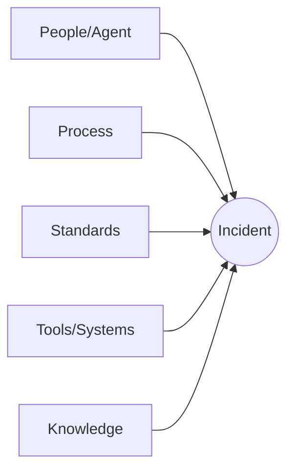

# Lessons Learned Framework

> The mandatory, rigorous method behind the Lessons Learned entries `Core/KNOWLEDGE_STANDARD.md` defines the *format* for and `Governance/CONTINUOUS_IMPROVEMENT_SYSTEM.md`'s harvest requires as *output #1* of every closed project. Those two documents say a Lessons Learned entry must exist and what shape it takes; this document says **how to actually get to a correct root cause** instead of stopping at the first plausible explanation — the difference between a lesson that prevents recurrence and one that just narrates an incident.

Governed by `Core/KNOWLEDGE_STANDARD.md`, `Governance/CONTINUOUS_IMPROVEMENT_SYSTEM.md`, `Intelligence/ORGANIZATIONAL_MEMORY.md`.

## Why Most "Lessons Learned" Fail

The typical failure isn't skipping the retrospective — it's stopping at the symptom. "The deploy failed because the migration script had a bug" is true and useless; it doesn't say why the bug reached deploy, why it wasn't caught earlier, or whether the same gap will let the next bug through too. This framework exists to force one more level of "why" than feels natural, every time.

## Mandatory Trigger

A full Lessons Learned review (this framework, not the lightweight sprint retro) is **mandatory**, not optional, when:

1. Any project closes (per `Governance/CONTINUOUS_IMPROVEMENT_SYSTEM.md` output #1), regardless of whether anything "went wrong" — successes need root-cause analysis too (§below).
2. A `Governance/RISK_MANAGEMENT_FRAMEWORK.md` risk is **Realized** (status changes to Realized) at any tier.
3. A `Core/QUALITY_STANDARD.md` Security gate fails in a way that reached staging or production.
4. A quality gate failure recurs a second time for the same root cause (per `Governance/CONTINUOUS_IMPROVEMENT_SYSTEM.md`'s triage rule).

A lightweight sprint retrospective (`Executive/Project_Manager/Templates/Sprint.md`) is sufficient for routine, low-impact friction; this framework's full rigor is reserved for the triggers above, so it doesn't become bureaucratic overhead applied indiscriminately to every minor hiccup.

## Root Cause Analysis Method

Two methods, chosen by situation complexity:

### 5 Whys (default — single causal chain)

Ask "why" five times, each answer becoming the next question, until the answer is something the organization can actually act on (a missing standard, an absent gate, an unclear spec) rather than an unchangeable fact of the universe ("the developer made a mistake" is never a root cause — ask why the system allowed that mistake to reach production).

**Example:**
1. Why did the deploy fail? → The migration script dropped a column still in use.
2. Why was a still-used column dropped? → The migration was written against a stale schema doc.
3. Why was the schema doc stale? → No process updates it when a migration runs.
4. Why is there no such process? → Schema documentation was never assigned an owner or a trigger to update.
5. Why wasn't that gap caught earlier? → No `Core/QUALITY_STANDARD.md` Documentation gate check exists for schema docs specifically, only for general documentation currency.

**Root cause:** Schema documentation has no update trigger or gate — not "a developer used a stale doc." **Resulting standard change:** add a schema-doc-update step to the Development stage's exit contract in the relevant `Departments/Engineering/` workflow, and a specific Documentation gate check item in `Checklists/`.

### Fishbone / Ishikawa (for multi-causal incidents)

Used when a single causal chain doesn't capture it — when several independent contributing factors combined. Categorize contributing factors under: **People/Agent** (was the Agent's spec adequate — `Core/AGENT_SPECIFICATION.md`), **Process** (was the Workflow/handoff adequate — `Core/WORKFLOW_STANDARD.md`), **Standards** (was a `Standards/`/`Core/` gap present), **Tools/Systems** (was tooling/automation a factor), **Knowledge** (was relevant `Intelligence/`/`Knowledge/` context available but unused, or genuinely missing).



Each branch is examined even if only one turns out to be a real contributing factor — the discipline of checking all five is what catches compound causes a single-chain 5 Whys would miss.

## Full Review Template

Stored at `Intelligence/LessonsLearned/<project-or-incident-slug>.md`, and summarized into `Memory/Lessons Learned.md` per `Core/KNOWLEDGE_STANDARD.md`'s format (this document is the detailed backing analysis; the Memory entry is the compact, cross-referenced pointer).

```markdown
# Lessons Learned: <title> — YYYY-MM-DD

## Trigger
Which mandatory trigger applies (project close / risk realized / security gate failure / recurrence), or "voluntary — flagged by <Agent/Department>".

## What Happened
Factual account — no root-cause interpretation yet, just what occurred, in sequence.

## Root Cause Analysis
Method used: 5 Whys | Fishbone
<the actual analysis — show the chain or the diagram's findings, not just the conclusion>

## Root Cause
The actual, actionable root cause — never "human error" or "bad luck" alone; if the analysis lands there, one more "why" is required (was the system designed to be forgiving of that class of human error?).

## What Worked
Even in an incident review, name what functioned correctly — what contained the damage, what surfaced the problem quickly, what process step did its job. This is not padding; per Core/KNOWLEDGE_STANDARD.md, confirming a working approach is as valuable to record as flagging a failure — otherwise a later "improvement" might accidentally remove something that was actually working.

## What Failed
The specific gap(s) identified by the root cause analysis.

## Standards Impacted
| Document | Current gap | Proposed change |
|---|---|---|
| Core/ or Governance/ or a Standards/ file or an Agent spec | | |

## Follow-Up Actions
| Action | Owner | Due | Status |
|---|---|---|---|
| | | | Proposed / In Progress / Done |

## Related
- Related Pattern/Anti-Pattern: Intelligence/PatternLibrary/ links
- Related risk entry: Governance/Risks/ or Projects/<name>/risks.md link
- Related decision/ADR: Governance/Decisions/ or ADR link
```

## Root Cause Analysis for Successes, Not Just Failures

A framework that only analyzes failures misses half of what compounds an organization's capability — per `Governance/CONTINUOUS_IMPROVEMENT_SYSTEM.md` output #2 (Successes). Apply the same "why" rigor to what worked: not "the launch went well" but *why* — was it a specific Pattern applied early, a Department sequencing choice, a risk caught before it materialized? Successes analyzed this shallowly ("we got lucky" / "the team was great") are exactly as useless as failures analyzed shallowly ("human error") — both skip the actionable layer.

## What Worked / What Failed — Standard of Rigor

- **"What worked" must name a specific, repeatable factor**, not a vague compliment — "the CEO's stated MVP bias let Engineering correctly deprioritize a Design ask, per `Executive/CEO/CEO_AGENT.md` Example 2" is usable; "the team communicated well" is not.
- **"What failed" must trace to the Root Cause Analysis**, not restate the symptom a second time under a different heading.

## Standards Impacted — The Bridge to Governance

This section is what actually connects a Lessons Learned entry to organizational change, per `Governance/CONTINUOUS_IMPROVEMENT_SYSTEM.md`'s Follow-Through Tracking: every "Standards Impacted" row becomes a proposed change routed through that system's ratification table. A Lessons Learned entry with an empty Standards Impacted section is only acceptable when the root cause was already fully covered by an existing standard and simply wasn't followed — in which case the entry says so explicitly, and the follow-up action is enforcement/training, not a new standard.

## Follow-Up Actions — Accountability

Every Follow-Up Action has one named owner and a due date — an unowned action is exactly the kind of item `Governance/CONTINUOUS_IMPROVEMENT_SYSTEM.md`'s Follow-Through Tracking table exists to catch at the next Quarterly Business Review. This framework's actions feed directly into that tracking table; they are not a separate, parallel to-do list.

## Anti-Patterns

- **Stopping at the first plausible cause.** The single most common failure of retrospectives generally — mitigated structurally by requiring at least 5 whys or a full fishbone pass, not by author discipline alone.
- **"Human error" as a terminal answer.** Always followed by "why did the system allow that error to have this consequence."
- **Lessons Learned as blame assignment.** Per `Executive/Chief_of_Staff/CHIEF_OF_STAFF_AGENT.md`'s communication style — findings are specific and non-accusatory; root cause analysis targets the system, not the Agent.
- **Skipping successes.** Treating Lessons Learned as failure-analysis-only misses the compounding value of understanding what to deliberately repeat.

## Metadata

```yaml
version: 1.0.0
status: active
last_reviewed: 2026-07-22
owner: Chief of Staff (framework stewardship + facilitation of mandatory reviews)
```
