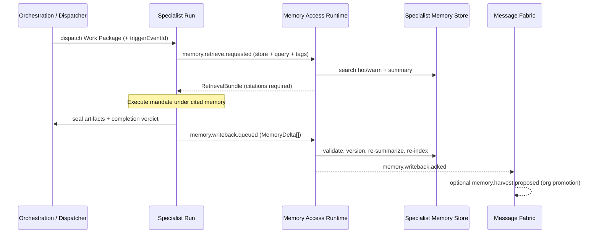
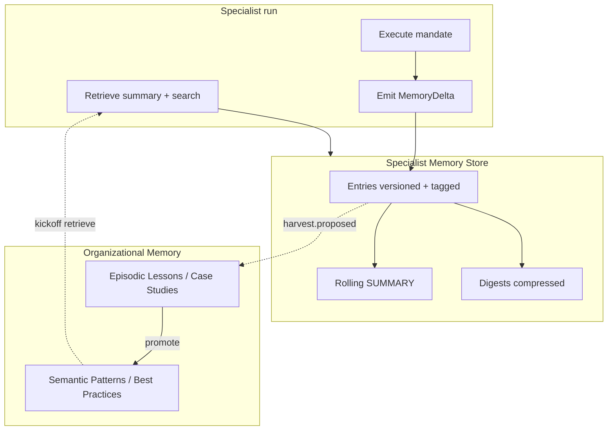

# Specialist Memory Architecture

> Persistent, searchable, versioned long-term memory **owned by each Specialist**.
> This is how Engineering remembers coding standards and past mistakes, QA remembers
> regressions, SEO remembers Lighthouse history, and Security remembers accepted risks —
> without every run starting from zero.

Governed by `Core/AI_OS_CONSTITUTION.md` §4 (compounding knowledge) and
`Core/SPECIALIST_ARCHITECTURE_STANDARD.md` §E9 (Memory Contract).
Extends — does not replace — `Intelligence/ORGANIZATIONAL_MEMORY.md`,
`Core/KNOWLEDGE_STANDARD.md`, and `Governance/KNOWLEDGE_GOVERNANCE.md`.
Executed mechanically by `Runtime/Domains/Memory_Access_Runtime.md`
(`packages/memory-access`); content SoR remains Intelligence.

**No implementation in this document** — architecture and contracts only.

---

## 1. Positioning

| Layer | Document | Role |
| --- | --- | --- |
| Org learning model | `ORGANIZATIONAL_MEMORY.md` | Working → Episodic → Semantic promotion across the OS |
| Document rules | `KNOWLEDGE_STANDARD.md` | Naming, versioning, Knowledge/ vs Memory/ |
| Governance | `KNOWLEDGE_GOVERNANCE.md` | Who may approve, retire, classify entries |
| **Specialist stores** | **This document** | Per-mandate durable memory: ownership, schema, run loop, compression |
| Runtime plumbing | `Memory_Access_Runtime.md` | Retrieve / writeback / citations / tenancy |

**Noun rule.** A **Specialist Memory Store** is a partition of Intelligence keyed by
`specialist_id` (and optionally `tenantId` / `projectId`). It is not a chat
transcript, not Runtime session state, and not a second SoR living only inside
an agent worker process.

**Forbidden.** Local-only org memory (files, SQLite, or prompt caches that never
write through Memory Access). Session scratchpads are allowed as *working*
context; they must be discarded or promoted at run end.

---

## 2. Goal

Every Specialist owns a long-term memory that is:

| Property | Meaning |
| --- | --- |
| **Persistent** | Survives process restarts, model swaps, and specialist version bumps |
| **Searchable** | Keyword + semantic retrieval before each run; citations required |
| **Versioned** | Every mutation is a new revision; prior revisions remain auditable |
| **Taggable** | Controlled + free-form tags for filter, routing, and harvest |
| **Summarized** | Always-current rolling summary for context budgets |
| **Compressible** | Cold entries roll into digests without losing recoverability |
| **Auto-updating** | Each completed run proposes memory writes; no optional “remember later” |

---

## 3. Ownership model

```
specialist_id  ──owns──▶  SpecialistMemoryStore
                              │
                              ├── entries[]     (versioned facts)
                              ├── summary       (rolling digest)
                              ├── index         (search / embeddings)
                              └── harvest outbox → Organizational Memory
```

| Concern | Owner | Accountable for |
| --- | --- | --- |
| Store content accuracy | The Specialist’s Department | Correctness of domain facts |
| Store schema & lifecycle | Intelligence (this architecture) | Uniform contracts across specialists |
| Access / tenancy / citations | Memory Access Runtime | No uncited retrieval; no cross-tenant leaks |
| Promotion to org Patterns / Lessons | Chief of Staff + owning Department | Per `ORGANIZATIONAL_MEMORY.md` triage |
| Spec declaration of read/write scope | Specialist spec §Memory Contract (E9) | What the specialist may touch |

One specialist **may read** peer or org memory when its Memory Contract allows
(e.g. QA reading Engineering “known bugs”). One specialist **may write** only
into stores it owns, plus the shared harvest outbox. Cross-store writes require
an explicit **memory handoff event**, never silent mutation of another
specialist’s partition.

---

## 4. Store layout (logical)

Logical paths (content SoR; physical backing is Memory Access + Intelligence
storage — adapter-private):

```
Intelligence/SpecialistMemory/
  <department>/
    <specialist_id>/
      STORE.yaml                 # store metadata, schema version, retention
      SUMMARY.md                 # always-current rolling summary
      entries/
        <entry_id>/
          HEAD.yaml              # current revision pointer + tags
          revs/
            v0001.yaml           # immutable revision bodies
            v0002.yaml
      digests/
        <period>.md              # compressed cold history
      indexes/                   # derived; rebuildable
```

Markdown under Intelligence remains human-auditable; embeddings and inverted
indexes are **derived views**, never the SoR.

---

## 5. Memory entry contract

Every entry is a versioned record. Indicative shape (contracts live in
`packages/contracts` when implemented — not in this doc):

```yaml
kind: specialist_memory_entry
schemaVersion: "1.0.0"
entryId: sme-eng-known-bug-redis-ttl
storeId: eng.app-delivery
specialistId: eng.app-delivery
department: Engineering

# Classification
category: known_bug          # see §7 catalogs
memoryKind: Lesson           # aligns with MemoryKind / extensions
retentionClass: durable      # ephemeral | standard | durable

title: "Redis cache invalidation misses tenant-scoped keys"
bodyRef: content://...       # full body (markdown / structured)
summary: "Always include tenantId in cache key for multi-tenant apps."

# Search & organization
tags:
  - domain:caching
  - severity:high
  - stack:redis
  - project:acme-lms          # optional project binding
labels: {}                   # structured key/value (contracts)

# Provenance
sourceRunId: run_...
sourceWorkPackageId: wp_...
sourceArtifactIds: []
correlationId: corr_...
createdAt: 2026-07-25T00:00:00Z
createdBy: eng.app-delivery@1.0.0

# Versioning
revision: 2
supersedesRevision: 1
contentHash: sha256:...
status: active               # active | superseded | archived | tombstoned

# Compression
temperature: hot             # hot | warm | cold
digestId: null               # set when rolled into a digest
```

### Versioning rules

- **Append-only revisions.** Corrections create `revision+1`; never rewrite
  `revs/vN`.
- **HEAD** points at the current revision; search indexes HEAD only by default.
- **Supersession** sets prior HEAD `status: superseded` with `superseded_by`.
- **Tombstone** soft-deletes for policy/PII; body may be redacted, metadata kept.
- Semver on the *store schema* (`STORE.yaml`) is independent of entry revisions.

### Tagging rules

| Tag class | Form | Examples |
| --- | --- | --- |
| Controlled | `namespace:value` | `severity:high`, `domain:caching`, `signal:lighthouse` |
| Free-form | lowercase kebab | `flaky-checkout`, `accepted-risk-xss-markdown` |
| Scope | `project:<id>`, `tenant:<id>`, `client:<slug>` | Filter at retrieve time |
| Lifecycle | `status:active` derived from entry, not manually tagged |

Controlled namespaces are registered per Department catalog (§7). Unknown
controlled namespaces are rejected at writeback validation.

---

## 6. Summary & compression

### 6.1 Rolling summary (`SUMMARY.md`)

Always present. Target size: fit in a specialist’s default context budget slice
(Architecture target: ≤ ~2–4k tokens equivalent). Contains:

1. **Mandate snapshot** — what this specialist currently “believes” matters most
2. **Top Hot entries** — titles + one-liners for the N highest-priority active items
3. **Open risks / watchlist** — unresolved items requiring attention next run
4. **Recent changes** — last K writebacks (entry id + delta type)
5. **Pointers** — links to digests and high-value durable entries

The summary is **derived**, regenerated on every successful writeback batch (or
on a debounce window). Agents may propose summary text; Memory Access validates
and seals it. The summary is never the only copy of a fact — every claim must
point at an `entryId`.

### 6.2 Temperature & compression

| Temperature | Meaning | Default policy |
| --- | --- | --- |
| **Hot** | Retrieved by default every run | Recent writes; high severity; open watchlist |
| **Warm** | Retrieved when query/tags match | Stable standards, historical but still relevant |
| **Cold** | Not in default retrieve; recoverable via search or digest | Aged, superseded, or low-recurrence |

**Compression pipeline** (scheduled + event-triggered):

```
Hot  --(age / capacity)--> Warm
Warm --(no hit in retention window)--> Cold
Cold --(batch)--> Digest (period rollup)
Digest remains searchable; cold entry bodies stay addressable by entryId
```

Digest contents: chronological bullet rollup of cold entries (title, summary,
tags, `entryId`), plus aggregate stats (e.g. “12 lighthouse audits, median perf
score 61 → 74”). Digests are themselves versioned entries of
`category: digest`.

Compression **never deletes** durable evidence required for audit; it only
changes default retrieval temperature and packing.

---

## 7. Specialist catalogs (owned domains)

Each specialist store declares a **category catalog** in `STORE.yaml`. Catalogs
below are the initial defaults for the four example mandates; other specialists
add catalogs under the same contract.

### 7.1 Engineering Memory — `eng.app-delivery`

| Category | What it holds | Typical tags |
| --- | --- | --- |
| `coding_standard` | Conventions the specialist must apply | `lang:php`, `style:psr` |
| `architecture` | Recurring structural decisions / constraints | `pattern:hexagonal` |
| `package` | Approved / banned packages and versions | `pkg:laravel`, `risk:supply-chain` |
| `known_bug` | Defects seen before; symptoms + fix pointers | `severity:*`, `area:*` |
| `past_mistake` | Errors this specialist made; what changed | `lesson:*` |
| `delivery_note` | CI, branch, release quirks | `ci:*` |

### 7.2 QA Memory — `qa.verify`

| Category | What it holds | Typical tags |
| --- | --- | --- |
| `known_regression` | Bugs that returned after fix | `suite:*`, `severity:*` |
| `historical_failure` | Past fail verdicts with evidence refs | `project:*` |
| `ignored_test` | Skipped/xfailed tests and why | `reason:flake\|obsolete\|debt` |
| `coverage_gap` | Surfaces repeatedly under-tested | `nfr:a11y\|perf\|security` |
| `fixture_quirk` | Env/data setup that breaks tests | `stack:*` |

### 7.3 SEO Memory — `seo.audit` (growth)

| Category | What it holds | Typical tags |
| --- | --- | --- |
| `previous_audit` | Prior audit verdicts + artifact ids | `project:*` |
| `lighthouse_history` | Score time series / deltas | `signal:lighthouse`, `metric:perf\|seo\|a11y\|bp` |
| `ranking_history` | Keyword / SERP snapshots | `query:*`, `geo:*` |
| `technical_debt_seo` | Unfixed SEO findings still open | `severity:*` |
| `content_pattern` | What improved rankings before | `page-type:*` |

### 7.4 Security Memory — (security review specialist)

| Category | What it holds | Typical tags |
| --- | --- | --- |
| `accepted_risk` | Explicit risk acceptances + expiry | `risk-id:*`, `expiry:*` |
| `known_vulnerability` | Open/known vulns and mitigations | `cve:*`, `severity:*` |
| `control_gap` | Missing controls still tracked | `control:*` |
| `threat_note` | Recurring threat patterns for this estate | `stride:*` |
| `exception` | Time-bounded policy exceptions | `approver:*` |

New specialists ship a catalog before first writeback; empty catalogs are
invalid at registration.

---

## 8. Run lifecycle — automatic memory update

Memory is a **closed loop** on every specialist run, not a post-project harvest
only (project harvest still promotes to org Episodic/Semantic per
`ORGANIZATIONAL_MEMORY.md`).



### 8.1 Retrieve (run start — mandatory)

Before producing judgment, the run must:

1. Load `SUMMARY.md` for its own store.
2. Issue a retrieval query built from Work Package text, project id, and
   mandate-relevant tags.
3. Optionally retrieve **allowed peer stores** listed in the Memory Contract
   (e.g. Engineering `known_bug` when QA triages a regression).
4. Attach citations to the run’s context handle. Producing sealed output with
   **zero memory retrieve** when the store is non-empty is a defect
   (`memory.citation.missing` / audit flag).

### 8.2 Writeback (run end — mandatory)

On `specialist.<mandate>.completed` (or equivalent run completion), the agent
emits a **MemoryDelta** batch:

| Delta op | Use |
| --- | --- |
| `create` | New fact learned this run |
| `revise` | Correct / extend an existing entry (new revision) |
| `retag` | Tag-only change |
| `supersede` | Replace meaning; mark prior superseded |
| `archive` | Lifecycle exit (retention) |
| `touch_summary` | Force summary regen without entry body change |
| `noop` | Explicit “nothing to remember” (still recorded for audit) |

Rules:

- At least one delta per completed run (`noop` allowed only when justified).
- Deltas reference `sourceRunId` / `correlationId` for lineage.
- Validation rejects deltas outside the specialist’s category catalog or write
  scope.
- Idempotency: `dedupKey = hash(specialistId, sourceRunId, entryId, op,
  contentHash)` so at-least-once completion events do not duplicate memory.

### 8.3 Harvest (async — organizational)

Writebacks that match promotion criteria (recurrence, Critical impact, or
explicit `promote: true`) enqueue `memory.harvest.proposed` for Chief of Staff /
Department triage into Lessons, Patterns, or Best Practices — the bridge into
`ORGANIZATIONAL_MEMORY.md`. Specialist memory stays the specialist’s own SoR;
harvest copies **references**, it does not strip the specialist store.

---

## 9. Search model

Retrieval is hybrid; both legs are required for production adapters:

| Leg | Mechanism | Strength |
| --- | --- | --- |
| **Structured** | Filters on `category`, `tags`, `projectId`, `status`, `temperature` | Precision |
| **Lexical** | Full-text over title, summary, body | Exact tokens, IDs, package names |
| **Semantic** | Embeddings over title+summary+body (existing memory-access vector path) | Fuzzy precedent |

Query planner (Memory Access):

1. Always include rolling summary in the bundle (citation = `summary`).
2. Apply structured filters from the Memory Contract.
3. Rank lexical ∪ semantic with reciprocal fusion (or equivalent).
4. Cap by `limit` and token budget; prefer Hot over Warm over Cold.
5. Return citations with `entryId`, `revision`, `score`, `contentRef`.

Agents must ground claims in citation ids. Ungrounded “I recall…” is a
quality failure.

---

## 10. Events (Memory Access plane)

Existing events remain canonical; specialist memory adds semantics, not a
parallel bus:

| Event | When |
| --- | --- |
| `memory.retrieve.requested` | Run start retrieval |
| `memory.retrieve.completed` | Bundle ready |
| `memory.retrieve.denied` | Trust / scope failure |
| `memory.writeback.queued` | Delta batch accepted for apply |
| `memory.writeback.acked` | Versions sealed + summary updated |
| `memory.citation.missing` | Defect: output without required citations |
| `memory.harvest.proposed` | *(new)* Candidate for org promotion |
| `memory.compress.completed` | *(new)* Temperature / digest rollup finished |
| `memory.store.diverged` | *(new)* Spec catalog vs live store mismatch |

All carry `correlationId` / `rootEventId` per Event Bus envelope rules.

---

## 11. Specialist spec binding (E9)

Every specialist frontmatter / Memory Contract must declare:

```yaml
memory:
  store_id: eng.app-delivery          # usually == specialist_id
  owned_categories: [coding_standard, architecture, package, known_bug, past_mistake, delivery_note]
  read_stores: [eng.app-delivery]     # may include peers
  write_scope: owned_only
  retention_default: durable
  retrieve_policy: mandatory_if_nonempty
  writeback_policy: mandatory_each_run
  summary_token_budget: 3000
  peer_read:                              # optional
    - store_id: qa.verify
      categories: [known_regression]
```

Registry rejects registration when:

- `owned_categories` is empty
- `write_scope` claims another specialist’s store
- Categories are not in the Department’s registered catalog

---

## 12. Consistency with existing MemoryKind

Current contract kinds (`Lesson`, `Pattern`, `BestPractice`, `Research`,
`DecisionIntel`, `CaseStudy`, `WorkingNote`) remain valid. Specialist memory
**maps** into them:

| Specialist category examples | MemoryKind |
| --- | --- |
| `past_mistake`, `historical_failure`, `known_regression` | `Lesson` |
| `coding_standard`, `architecture`, `content_pattern` | `BestPractice` / `Pattern` |
| `previous_audit`, `lighthouse_history`, `ranking_history` | `CaseStudy` or structured extension |
| `accepted_risk`, `known_vulnerability` | `DecisionIntel` (risk decision) |
| Run scratch before seal | `WorkingNote` (ephemeral) |

Architecture allows extending `MemoryKind` with `SpecialistEntry` later; until
then, `memoryKind` + `category` together disambiguate.

---

## 13. Tenancy, trust, and redaction

- `tenantId` / `projectId` on entries enforce isolation at Memory Access
  (existing scope guard).
- Security categories (`accepted_risk`, vulnerability detail) default to
  higher Trust class; retrieve denied emits `memory.retrieve.denied`.
- PII in bodies follows Audit + Trust redaction; tombstone + redacted revision
  on policy demand.
- Cross-tenant semantic search is forbidden even if embeddings would match.

---

## 14. Failure modes

| Failure | Detection | Response |
| --- | --- | --- |
| Run skips retrieve | Audit / `memory.citation.missing` | Fail quality gate or flag rework |
| Run skips writeback | Missing delta on completion | Auto-enqueue `noop` demand or fail completion contract |
| Duplicate writebacks | `dedupKey` collision | Ack as idempotent success |
| Summary drift (claims without entries) | Validation on seal | Reject summary, keep prior |
| Store grows without compression | Hot count / size SLO breach | Trigger compress job |
| Peer write attempt | Scope guard | Deny + audit |
| Catalog drift after spec change | `memory.store.diverged` | Block writes until reconcile |

---

## 15. Metrics

| Metric | Target intent |
| --- | --- |
| Retrieve-before-produce rate | → 100% when store nonempty |
| Writeback-per-completion rate | → 100% (including explicit `noop`) |
| Citation completeness on sealed artifacts | → 100% for memory-grounded claims |
| Hot entry count per store | Bounded (compress when over cap) |
| Duplicate entry rate (near-duplicate creates) | Low; revise preferred |
| Harvest promotion lag | Within Chief of Staff triage cadence |
| Cross-tenant deny correctness | Zero false allows |

---

## 16. Explicit non-goals

- Not a replacement for `Projects/<name>/` working context packages.
- Not a vector DB product decision — embeddings are an adapter detail behind
  Memory Access.
- Not chat-transcript archival as memory (transcripts may *feed* deltas after
  extraction).
- Not Department-owned duplicate stores that bypass specialist partitions.
- No implementation, migrations, or schema files ship from this document alone.

---

## 17. Relationship diagram



---

## Metadata

```yaml
version: 1.0.0
status: active
last_reviewed: 2026-07-25
ratified_by: RFC-005
owner: Intelligence (architecture), each Department (store content), Memory Access Runtime (plumbing)
supersedes: null
related:
  - Intelligence/ORGANIZATIONAL_MEMORY.md
  - Core/KNOWLEDGE_STANDARD.md
  - Core/SPECIALIST_ARCHITECTURE_STANDARD.md
  - Runtime/Domains/Memory_Access_Runtime.md
  - Governance/CONTINUOUS_IMPROVEMENT_SYSTEM.md
```
