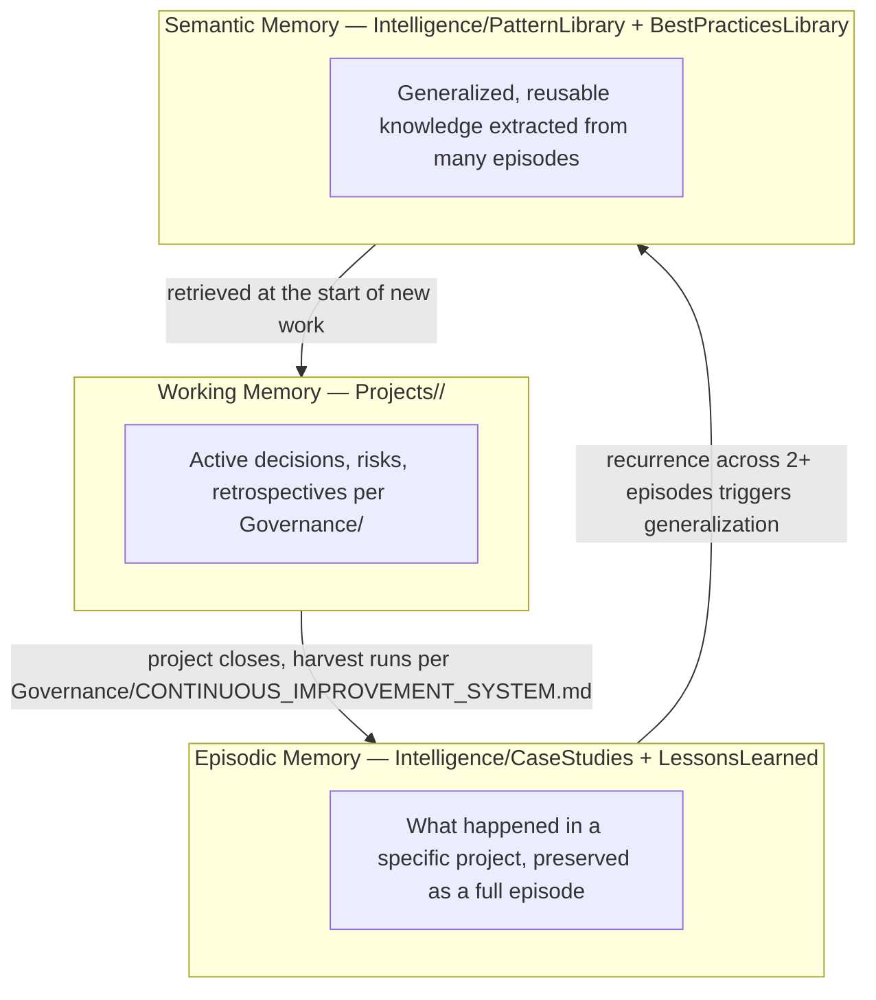
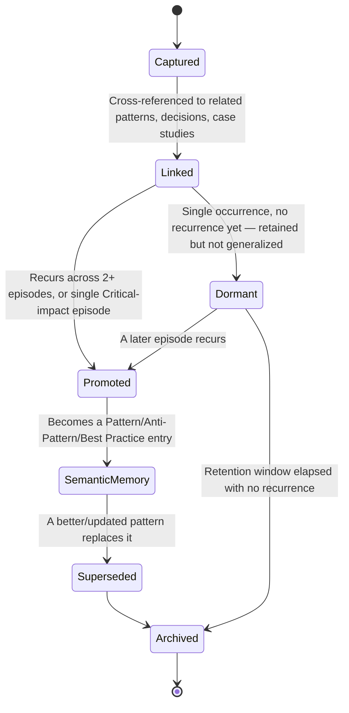
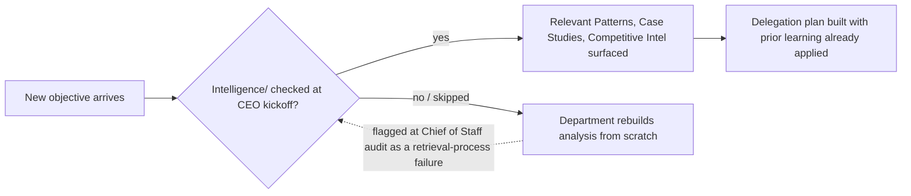

# Organizational Memory

> The long-term memory model for Umer AI OS — how what the organization learns from one project stays retrievable and useful ten years and thousands of projects later. `Core/KNOWLEDGE_STANDARD.md` defines Knowledge/Memory at the document level (naming, versioning, Knowledge vs. Memory). `Governance/KNOWLEDGE_GOVERNANCE.md` defines the approval process on top of that. This document defines the **memory architecture** — what kind of memory this is, who owns which layer, how it's retrieved when needed, and when it ages out. Nothing here duplicates those two documents; it extends them into a genuine organizational memory system rather than a folder of files.

Governed by `Core/AI_OS_CONSTITUTION.md` §4 (Long-Term Philosophy — "compounding knowledge is the actual product") and `Governance/CONTINUOUS_IMPROVEMENT_SYSTEM.md` (the mechanism that feeds this memory).

## Why "Intelligence" and Not Just "More Knowledge"

`Knowledge/` and `Memory/` store *facts and records* — a pattern, a client preference, a lesson. `Intelligence/` is what happens when those records are **connected, weighted, and made retrievable at the moment of need** — the difference between a filing cabinet and a colleague who remembers the right precedent unprompted. A fact sitting unlinked in `Knowledge/Database/` is a record. The same fact cross-referenced into `Intelligence/PatternLibrary/`, tagged to the client it recurred with in `Intelligence/OrganizationalMemory/`, and surfaced automatically the next time a similar project starts — that's intelligence. This folder is the connective and retrieval layer; `Knowledge/`/`Memory/` remain the underlying record store it draws from and writes back to.

## The Three Layers of Memory



- **Working memory** is short-lived and project-scoped — the live decisions, risks, and in-flight retrospective notes in `Projects/<name>/`. It is volatile in the sense that it's actively changing, not in the sense that it's disposable.
- **Episodic memory** is what working memory becomes once a project closes: a preserved, dated record of a specific situation and what happened — a Lesson Learned entry, a Case Study. Episodic memory is never generalized on its own; a single episode is evidence, not yet a rule.
- **Semantic memory** is what emerges when the same signal recurs across multiple episodes — a Pattern, an Anti-Pattern, a Best Practice. This is the layer new Agents and Departments actually consult by default, because it's pre-generalized and doesn't require re-reading dozens of old projects.

This three-layer split is the answer to "where does the organization learn" — learning is specifically the Episodic → Semantic promotion step, and it is a defined, checkable process (§Memory Lifecycle), not something assumed to happen automatically just because records exist.

## Memory Lifecycle



1. **Captured** — a fact, decision, or lesson is written down at the moment it's known (a bug fix, an ADR, a completed retrospective per `Governance/CONTINUOUS_IMPROVEMENT_SYSTEM.md`). Nothing enters organizational memory informally; capture always happens through one of the standard artifacts (`Governance/DECISION_LOG_STANDARD.md`, `Core/KNOWLEDGE_STANDARD.md` Lessons Learned, `Intelligence/CASE_STUDY_STANDARD.md`).
2. **Linked** — the entry is cross-referenced to related patterns, decisions, ADRs, and prior episodes, per `Intelligence/PATTERN_LIBRARY_STANDARD.md`'s cross-referencing rules. An unlinked entry is findable only by luck; linking is what makes retrieval (§below) actually work.
3. **Promoted** — per the Triage rule already established in `Governance/CONTINUOUS_IMPROVEMENT_SYSTEM.md` (second occurrence, or single Critical-impact occurrence), the episode is generalized into semantic memory: a Pattern, Anti-Pattern, or Best Practice entry, owned going forward by the relevant Department.
4. **Dormant** — a single, non-critical occurrence stays in episodic memory, retained and linked, but not yet generalized — avoiding the "overreacting to one data point" failure mode.
5. **Archived** — per `Governance/DOCUMENT_LIFECYCLE.md`'s retention rules, applied to memory specifically: a Dormant entry with no recurrence within its retention window (default 2 years for episodic memory, given how much slower some patterns are to recur than a single project cycle) moves to archive, kept for audit, out of active retrieval by default.

## Memory Ownership

| Memory type | Owner | Accountable for |
|---|---|---|
| Working memory (`Projects/<name>/`) | Project Manager (per `Executive/Project_Manager/PROJECT_MANAGER_AGENT.md`) | Currency during the project |
| Episodic memory (Lessons Learned, Case Studies) | Chief of Staff (cross-project), owning Department (subject-matter accuracy) | Capture completeness, correct linking |
| Semantic memory (Patterns, Best Practices) | Owning Department per pattern's domain | Accuracy, currency, correct promotion/supersession |
| Decision Intelligence (cross-references between decisions/ADRs/outcomes) | Chief of Staff | Integrity of the links, not the underlying decisions themselves |
| Competitive/Research/Innovation memory | Business + Product (jointly) | Freshness against real market change |

No memory entry is ownerless — an entry discovered without a clear owner at any Chief of Staff audit (`Governance/MEETING_OPERATING_SYSTEM.md` Monthly Business Review) is reassigned immediately, per `Governance/KNOWLEDGE_GOVERNANCE.md`'s ownership rule extended to this layer.

## Retrieval Strategy

Organizational memory is only valuable if it surfaces **at the moment a new Agent needs it**, not only when someone thinks to search for it. Retrieval happens at three trigger points:

1. **Project kickoff (CEO's Workflow, `Executive/CEO/CEO_AGENT.md`):** before delegation, the CEO's existing "check Knowledge/ and Projects/ for prior relevant work" step is extended to explicitly check `Intelligence/PatternLibrary/`, `Intelligence/CaseStudies/`, and `Intelligence/CompetitiveIntelligence/` for the objective's domain — this is the single highest-leverage retrieval point, since it's where "every Agent starts from zero" is prevented at the root.
2. **Task/Agent execution:** any Agent whose `Core/AGENT_SPECIFICATION.md` §5 (Knowledge Required) names a domain checks `Intelligence/PatternLibrary/` and `Intelligence/BestPracticesLibrary/` for that domain before producing original analysis — per the reuse-check flowchart already established in `Core/KNOWLEDGE_STANDARD.md`, now extended to include semantic-memory sources specifically.
3. **Incident/bug response:** before root-causing a defect from scratch, the responding Agent checks whether the same symptom is already linked in episodic memory (a prior Lessons Learned or Case Study entry) — this is the direct mechanism behind the "Redis cache invalidation" example: the bug is checked against memory before and after resolution, not just fixed and forgotten.

Retrieval is a required step, not a nicety — its omission is itself checkable at Chief of Staff audit (was relevant existing intelligence cited in the deliverable) exactly as `Governance/KNOWLEDGE_GOVERNANCE.md`'s reuse enforcement already specifies for `Knowledge/`.

## Archiving Rules

- Archiving never means deleting — per `Core/KNOWLEDGE_STANDARD.md` and `Governance/DOCUMENT_LIFECYCLE.md`, an archived memory entry remains available for audit, just out of default retrieval.
- A Pattern or Best Practice that's Superseded is archived only after its `superseded_by` pointer has been live for one full review cycle (Quarterly), so anything still referencing the old version has time to be caught and updated.
- Case Studies are never archived on a timer alone — they remain in active retrieval as long as any current Department or Pattern references them, regardless of age, because a well-chosen historical case can remain instructive far longer than a specific technical pattern does.
- Competitive Intelligence and Research Library entries have the shortest default retention before archive-from-active-view (12 months) because market and technology facts age fastest — see `Intelligence/COMPETITIVE_INTELLIGENCE_FRAMEWORK.md` and `Intelligence/RESEARCH_LIBRARY_STANDARD.md` for category-specific cadence.

## How This Prevents "Every Future Agent Starts From Zero"



The failure mode this document exists to close isn't "we don't write things down" — `Core/` and `Governance/` already solve that. It's "we write things down but the next Agent never reads them because nothing forced the check." Retrieval Strategy (§above) is that force; the Chief of Staff audit is the check on the check.

## Metadata

```yaml
version: 1.0.0
status: active
last_reviewed: 2026-07-22
owner: Chief of Staff (architecture stewardship), each Department (its own semantic memory entries)
```
