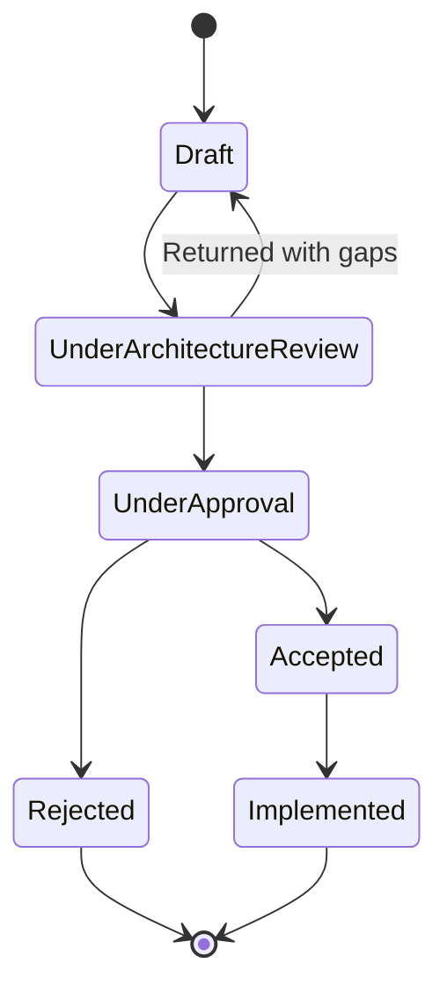

# RFC Process

> The architecture-evolution workspace for Umer AI OS — not an operational layer like `Core/`, `Executive/`, `Governance/`, `Intelligence/`, `Execution/`, or `Business/`, but the mechanism by which any of *those* layers changes structurally. An RFC captures a proposal and its debate; an ADR (`Governance/ARCHITECTURE_DECISION_RECORDS_STANDARD.md`) captures the final decision once ratified. RFCs have no runtime authority and no organizational responsibility of their own — they exist purely to make architectural evolution explicit, reviewable, and historically traceable.

Governed by `Core/AI_OS_CONSTITUTION.md` §12 (the amendment process this formalizes), `Governance/DECISION_LOG_STANDARD.md` and `Governance/ARCHITECTURE_DECISION_RECORDS_STANDARD.md` (what an accepted RFC ultimately produces).

## Why RFCs Are Not a Seventh Layer

Every operational layer in this OS (Core through Business) has agents, mandates, or mechanisms that run day to day. RFC has none of that — it is a **workspace**, structurally closer to a meeting room than a Department. An RFC never executes anything, never holds runtime state, and never appears in `Governance/ORGANIZATIONAL_CHART.md`'s reporting hierarchy. Its only output is a decision that some other layer then absorbs. Keeping it out of the operational layer stack is itself the point — it's what keeps architectural evolution from becoming yet another thing with its own competing authority.

## When an RFC Is Required

An RFC is mandatory before any change that:

1. Adds, removes, or redefines the boundary of an operational layer (Core, Executive, Governance, Intelligence, Execution, Business, or any future layer at that scope).
2. Changes a cross-layer interface (e.g., `Business/LAYER_INTERFACES.md`, `Execution/ARTIFACT_CONTRACTS.md`'s registry mechanics themselves — not a single new artifact type addition, which is a lighter-weight change, see below).
3. Introduces a wholly new top-level folder (a new layer, or a new bounded context at the layer level).
4. Materially changes `Core/AI_OS_CONSTITUTION.md` itself, per that document's own §12 amendment process — an RFC is the vehicle for that process, not a separate parallel one.

An RFC is **not required** for: adding a new Department (that's `Governance/ORGANIZATIONAL_CHART.md`'s intake gate), adding a new registered artifact type to an existing registry (`Execution/ARTIFACT_CONTRACTS.md`'s own addition process), or any routine `Governance/CONTINUOUS_IMPROVEMENT_SYSTEM.md` harvest-driven standard change that stays within an existing layer's stated scope. The dividing line: **does this change what a layer fundamentally is or how layers relate to each other** (RFC) **vs. does this change something within an already-defined layer's existing scope** (the layer's own normal amendment path).

## The RFC Lifecycle

```mermaid
flowchart TD
    A[RFC drafted — proposal + debate] --> B[Architecture Review]
    B --> C{Sound in principle?}
    C -- no --> D[Returned to author with specific concerns]
    D --> A
    C -- yes --> E[Executive + Governance Approval]
    E --> F{Approved?}
    F -- no, Rejected --> G[RFC marked Rejected, reasoning recorded, archived — never deleted]
    F -- yes, Accepted --> H[Affected layer(s) updated]
    H --> I[ADR created or updated per Governance/ARCHITECTURE_DECISION_RECORDS_STANDARD.md]
    I --> J[RFC marked Implemented, cross-linked to the resulting ADR/layer changes]
```

- **RFCs capture proposals and debate** — the reasoning, alternatives, and trade-offs considered, in enough detail that a future reader understands not just what was decided but what was argued.
- **ADRs capture the final architectural decision** — once an RFC is Accepted and implemented, the resulting structural decision gets its own ADR (or Decision Log entry, if the change is more organizational than technical — see `Governance/DECISION_LOG_STANDARD.md` vs. `Governance/ARCHITECTURE_DECISION_RECORDS_STANDARD.md`'s own dividing line), so the permanent record lives in the same place every other architectural decision lives, cross-linked back to the RFC that originated it.
- **Governance owns the approval process mechanics** — same Quality/rigor bar as any other Governance-level decision (`Governance/DECISION_LOG_STANDARD.md`'s Alternatives Considered rigor applies in full).
- **Core, Business, Intelligence, Execution, and any other affected layer own the resulting change** to their own documents — an RFC never edits another layer's files directly; it results in a change request that layer's own steward implements.

## RFC Template Location

See `RFC/Templates/RFC_TEMPLATE.md` for the authoring format. Numbered records live at `RFC/Records/RFC-###-<slug>.md`, sequential and never reused, mirroring `Governance/DECISION_LOG_STANDARD.md`'s numbering convention.

## Architecture Review (Stage 1)

The first gate — checked before any Executive/Governance time is spent:

- Does the proposal clearly state which layer(s) it affects and why the change belongs at the RFC level rather than a layer's own internal amendment path?
- Are at least two real alternatives considered, per the same rigor `Governance/DECISION_LOG_STANDARD.md` already requires of any decision record?
- Does it identify what breaks — which existing Agents, Workflows, artifacts, or interfaces depend on the current structure and would need to migrate?

A proposal failing this gate is returned to the author with specific gaps — never rejected outright at this stage, since Architecture Review is a quality check on the proposal's completeness, not a verdict on its merits.

## Executive + Governance Approval (Stage 2)

- **CEO** evaluates the proposal's business/strategic merit — does this architectural change serve `Core/AI_OS_CONSTITUTION.md`'s Vision/Mission, and is the disruption to affected layers worth the benefit, per `Core/DECISION_FRAMEWORK.md`.
- **Chief of Staff** evaluates systemic/process soundness — does this fit cleanly with `Governance/ORGANIZATIONAL_CHART.md`'s existing structure, does it introduce unnecessary complexity, is the migration path for affected components realistic.
- Both must approve for Acceptance; either can reject, with the specific reasoning recorded in the RFC record itself (never a bare "rejected").

## Accepted → Implementation → ADR

Once Accepted:

1. The affected layer's steward (e.g., Business layer stewardship for a Business interface change, per `Business/BUSINESS_LAYER_CHARTER.md`'s Metadata owner) makes the actual documentation change.
2. A `Governance/ARCHITECTURE_DECISION_RECORDS_STANDARD.md` ADR (for technical/structural architecture) or `Governance/DECISION_LOG_STANDARD.md` entry (for organizational/business structure) is created, cross-linked to the originating RFC.
3. The RFC itself is marked `Implemented`, with links to every changed file — the RFC remains the historical record of *why* and *what was debated*; the ADR/Decision Log entry remains the record of *what was finally decided*.

## Rejected RFCs Are Never Deleted

Per `Core/KNOWLEDGE_STANDARD.md`'s retirement rules, applied here: a Rejected RFC stays archived at `RFC/Records/`, because the reasoning behind rejecting an architectural change is exactly as valuable as the reasoning behind accepting one — a future contributor proposing something similar should find the prior rejection and its reasoning before re-litigating the same ground from scratch.

## RFC Status States



## Anti-Patterns

- **Treating RFC as an operational layer with its own authority.** It never runs anything, holds no RACI position in `Governance/ORGANIZATIONAL_CHART.md`, and never bypasses the layer whose document it's ultimately changing.
- **Using the RFC process for routine, in-scope changes.** Every layer's own amendment path (a Department's normal spec update, an artifact registry addition) should not be forced through the heavier RFC gate — RFC is reserved for genuine cross-layer or foundational structural change.
- **Skipping straight to implementation without Architecture Review.** The two-stage gate (Architecture Review, then Executive+Governance Approval) exists specifically so proposal quality and proposal merit are checked separately — a well-argued but ultimately-wrong proposal and a good idea poorly argued fail for different reasons and should be distinguishable in the record.
- **Deleting a Rejected RFC.** Always archived, per the retirement rule above.

## Metadata

```yaml
version: 1.0.0
status: active
last_reviewed: 2026-07-22
owner: Chief of Staff (process stewardship), CEO + Chief of Staff (joint approval authority)
```
