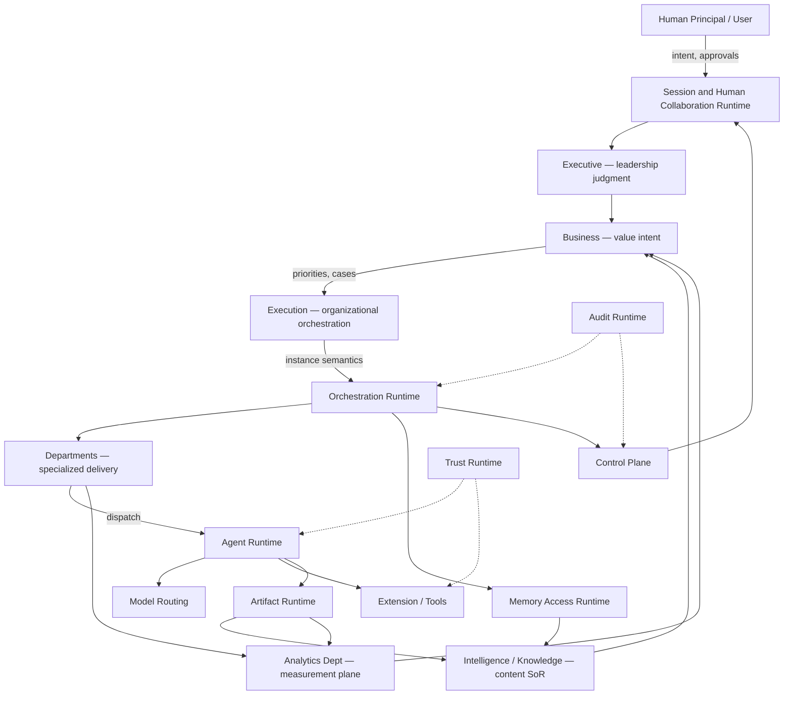

# Runtime Communication Model

> How information flows across the completed organization once Runtime exists. Runtime is the mechanical midplane — not a replacement for Executive, Business, Execution, or Departments.

Governed by `Runtime/RUNTIME_PLATFORM_CHARTER.md`.

## End-to-End Flow



## Plane Separation

| Plane | Carries | Must not carry |
|---|---|---|
| **Intent plane** | User→Executive→Business decisions | Raw tool egress, model logits as decisions |
| **Orchestration plane** | Execution semantics → Orchestration commands | Portfolio strategy |
| **Delivery plane** | Department/Agent work → Artifacts | Gate self-waiver |
| **Evidence plane** | Artifacts → Intelligence harvest; Analytics models | Secret rewriting of Audit |
| **Control plane** | Policy/gates/HITL | Quiet side channels |
| **Platform plane** | Observability/economy/trust internals | Product UX metrics ownership |

## Message Fabric Usage

- **Commands:** Orchestration → Agent dispatch, Control → wait/resume  
- **Events:** `artifact.sealed`, `gate.pass`, `agent.completed`, `economy.budget_exceeded`  
- **Queries:** Registry resolve, Context fetch, Audit verify  

Departments do not open private Runtime sockets that bypass Fabric for cross-domain coordination.

## Feedback Loops (Preserved)

1. Analytics insights → Business (value loop) — Runtime only transports/measures OS events  
2. Intelligence harvest ← Artifact/Agent outcomes via Memory Access writeback contracts  
3. Execution Continuous Feedback remains organizational; Runtime supplies mechanical signals  

## Metadata

```yaml
version: 1.0.0
status: active
last_reviewed: 2026-07-22
owner: Chief Platform Architect
```
