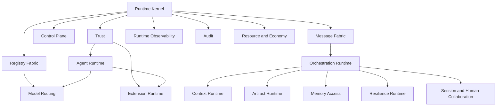

# Runtime Domain Map — Challenge & Consolidation

> Candidate list of 35 runtime domains challenged for a decade-valid kernel. Result: **17 domains**. Merges and rejects below are architectural decisions, not implementation preferences.

Governed by `Runtime/RUNTIME_PLATFORM_CHARTER.md`.

## Challenge Outcomes

| # | Candidate | Verdict | Rationale |
|---|---|---|---|
| 1 | Runtime Kernel | **Keep** | Invariants, boot, tenancy baseline, hard stops |
| 2 | Agent Runtime | **Keep** | Invocation/isolation of Agents (specs remain Core) |
| 3 | Capability Registry | **Reject as Runtime-owned registry** | Nouns owned by `Enterprise_Architecture/`. Runtime has **Capability Resolver** inside Registry Fabric |
| 4 | Skill Registry | **Merge → Registry Fabric** | Skills are Agent-callable units; not a second truth store |
| 5 | Tool Registry | **Merge → Registry Fabric** | Tools + skills + plugin manifests share one registry plane |
| 6 | Context Engine | **Keep as Context Runtime** | Mechanics for Execution’s Context Package — Execution owns package *semantics* |
| 7 | Memory Runtime | **Keep as Memory Access Runtime** | Plumbing only; Intelligence owns memory content |
| 8 | Planning Engine | **Reject as decision owner** | Planning *judgment* is Executive/Business. Plan *materialization* merges into Orchestration Runtime |
| 9 | Task Orchestrator | **Merge → Orchestration Runtime** | |
| 10 | Workflow Scheduler | **Merge → Orchestration Runtime** | Implements Execution Workflow Engine mechanically |
| 11 | Approval Engine | **Merge → Control Plane Runtime** | Implements Execution Approval Gates waits |
| 12 | Policy Enforcement Engine | **Merge → Control Plane Runtime** | PEP for Governance — does not author policy |
| 13 | Model Routing Engine | **Keep** | AI-specific; no other layer owns model selection |
| 14 | Communication Bus | **Merge → Message Fabric** | Sync command/query plane |
| 15 | Event Bus | **Merge → Message Fabric** | Async event plane — one fabric, two planes |
| 16 | Artifact Runtime | **Keep** | Mechanical store/transfer for Execution Artifact Contracts |
| 17 | State Management | **Merge → Kernel + Orchestration** | Avoid parallel “state empires” |
| 18 | Execution Monitoring | **Merge → Runtime Observability** | |
| 19 | Observability | **Keep as Runtime Observability** | Platform health ≠ Eng product Observability ≠ Analytics |
| 20 | Logging | **Merge → Runtime Observability** | Logs are a signal class, not a domain |
| 21 | Audit Runtime | **Keep** | Immutable accountability stream for Governance |
| 22 | Failure Recovery | **Merge → Resilience Runtime** | Implements Execution Failure Recovery mechanically |
| 23 | Retry Engine | **Merge → Resilience Runtime** | |
| 24 | Checkpoint Engine | **Merge → Resilience Runtime** | |
| 25 | Session Management | **Merge → Session & Human Collaboration Runtime** | |
| 26 | Cost Management | **Merge → Resource & Economy Runtime** | |
| 27 | Performance Optimization | **Merge → Resource & Economy Runtime** | Optimization is policy+allocation, not a freestanding brain |
| 28 | Resource Allocation | **Merge → Resource & Economy Runtime** | |
| 29 | Human Collaboration Runtime | **Merge → Session & Human Collaboration Runtime** | HITL is a session class |
| 30 | Plugin Runtime | **Merge → Extension Runtime** | |
| 31 | External Integration Runtime | **Merge → Extension Runtime** | |
| 32 | Security Runtime | **Merge → Trust Runtime** | Enforcement only; Security Dept owns controls |
| 33 | Identity Runtime | **Merge → Trust Runtime** | |
| 34 | Permission Runtime | **Merge → Trust Runtime** | |
| 35 | Configuration Runtime | **Merge → Runtime Kernel** | Config is kernel concern; avoid config-as-product |

### Missing domains added by review

| Domain | Why |
|---|---|
| **Control Plane Runtime** | Approval + Policy PEP must share one wait/decision substrate |
| **Registry Fabric** | Single registry plane prevents Tool/Skill/Plugin/Capability-resolver sprawl |
| **Message Fabric** | Unified bus prevents dual-source-of-truth events vs RPC |
| **Resilience Runtime** | Retry/checkpoint/recovery must be one consistency model |
| **Resource & Economy Runtime** | Cost+quota+perf without a “optimization daemon” that bypasses policy |

## Final Domain Set (17)

1. Runtime Kernel  
2. Trust Runtime  
3. Control Plane Runtime  
4. Registry Fabric  
5. Model Routing Engine  
6. Context Runtime  
7. Memory Access Runtime  
8. Orchestration Runtime  
9. Artifact Runtime  
10. Message Fabric  
11. Resilience Runtime  
12. Session & Human Collaboration Runtime  
13. Resource & Economy Runtime  
14. Runtime Observability  
15. Audit Runtime  
16. Extension Runtime  
17. Agent Runtime  

Each is specified under `Runtime/Domains/`.

## Hierarchy



## Metadata

```yaml
version: 1.0.0
status: active
last_reviewed: 2026-07-22
owner: Chief Platform Architect
```
