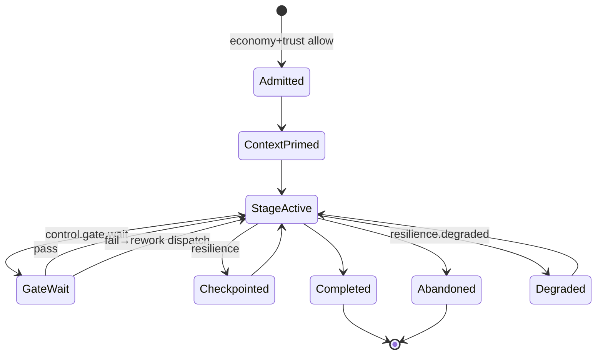

# Runtime Lifecycles

> Complete lifecycle architecture for the Runtime Platform. Organizational meaning of requests/workflows remains in `Execution/`; this document defines mechanical lifecycles the kernel runs.

Governed by `Runtime/RUNTIME_PLATFORM_CHARTER.md`.

## 1. Runtime Hierarchy (Recap)

```text
Runtime Kernel
 ├─ Trust Runtime
 ├─ Control Plane Runtime
 ├─ Registry Fabric
 ├─ Message Fabric
 ├─ Runtime Observability
 ├─ Audit Runtime
 ├─ Resource & Economy Runtime
 └─ (consumers)
      Orchestration Runtime
       ├─ Context Runtime
       ├─ Artifact Runtime
       ├─ Memory Access Runtime
       ├─ Resilience Runtime
       └─ Session & Human Collaboration
      Agent Runtime → Model Routing, Extension Runtime
```

## 2. Execution Lifecycle (Mechanical)

Maps 1:1 onto `Execution/WORKFLOW_ENGINE.md` states without redefining them.



## 3. Request Lifecycle (Mechanical Binding)

| Execution stage | Runtime binding |
|---|---|
| Intake | Session captures raw ask → Artifact/Request record handle |
| Classification / Prioritization / Scoping | Orchestration does **not** invent results — Executive/Execution semantics produce them; Runtime stores & advances |
| Routing | Orchestration creates Run Record bound to EXEC semantics |
| Closure | Orchestration terminal + Audit |

Runtime never classifies business type itself.

## 4. Context Lifecycle

`created → primed (memory retrieve) → inherited on stage → appended → freshness check → compacted (safe) → sealed on terminal`

Stale + constraint change ⇒ `context.stale` ⇒ Orchestration must refresh before Agent dispatch.

## 5. Memory Lifecycle (Access Only)

`retrieve.requested → trust check → Intelligence fetch → citation bundle → context attach`  
`writeback.queued → Intelligence ack` (Runtime does not mutate Intelligence SoR directly beyond contracted APIs)

## 6. Artifact Lifecycle

`draft → validated → transferred → accepted → sealed (immutable) → superseded (new version)`  
Rejected validation never seals. Accepted+sealed edits require supersession.

## 7. Event Lifecycle

`schema-register → publish → authorize subscribe → deliver → ack|dlq → retain per class`  
Consequential events also fan-in to Audit.

## 8. Approval Lifecycle

`control.approval.requested → hitl.wait → session.resolve → control.gate.pass|fail → orch resume`  
Timeout → escalate per Control Plane timers → Executive/Human paths (organizational), Runtime only signals.

## 9. Recovery Lifecycle

`failure.detected → classify (Execution categories via mapped signals) → checkpoint? → retry | await org decision → rollback.mechanical if authorized → resume|abandon`  
CEO organizational Rollback approval is HITL; Resilience applies mechanical effects after Audit.

## 10. Session Lifecycle

`open → bind principals → active (messages/HITL) → handover? → close|timeout`  
Closed sessions cannot approve. Transcripts are not Decision Logs.

## 11. Agent Lifecycle

`dispatch → mandate.bind → sandbox.open → tool/model loops → output.capture → mandate.check → seal outputs → complete|kill`  
Mandate violation ⇒ kill + Audit + Orchestration fail path.

## 12. Tool Lifecycle

`manifest.register → trust.scope → resolve → invoke (ext or native) → idempotency → receipt → audit`  
Deprecated tools resolve with warning then deny after sunset.

## 13. Capability Lifecycle (Resolver)

`EA capability ID → registry.binding → provider (Department/Agent/skill) → invoke path`  
Unbound Capability ⇒ resolve miss ⇒ Orchestration blocks with explicit gap (does not invent provider).

## Metadata

```yaml
version: 1.0.0
status: active
last_reviewed: 2026-07-22
owner: Chief Platform Architect
```
