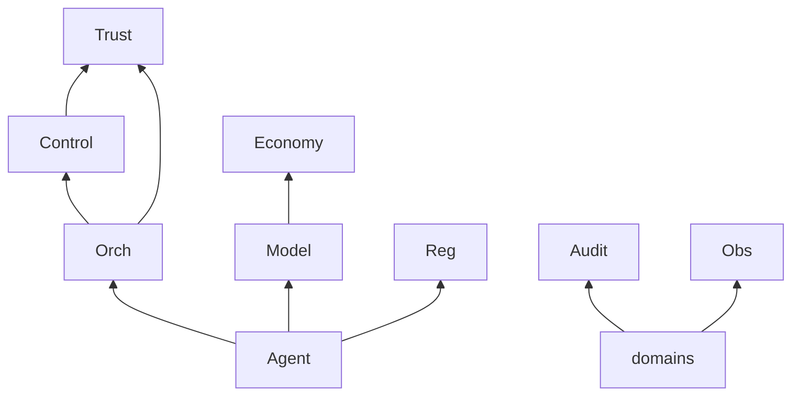

# Runtime Ownership Boundaries

> Single-Accountable map. If two rows claim the same concern, the architecture is wrong — fix here before implementation.

Governed by `Runtime/RUNTIME_PLATFORM_CHARTER.md`.

## Layer vs Runtime

| Concern | Accountable |
|---|---|
| Constitutional principles | Core |
| Leadership judgment / delegation | Executive |
| Value / investment | Business |
| Org policy / RACI / risk appetite / KPI design rules | Governance |
| Organizational memory content | Intelligence |
| Request/workflow/gate/handoff *meaning* | Execution |
| Capability/Domain nouns | Enterprise Architecture |
| Department delivery quality | Respective Departments |
| **Mechanical kernel** | **Runtime** |

## Runtime Internal Accountable Map

| Concern | Accountable domain |
|---|---|
| Boot, tenant baseline, kernel config | Runtime Kernel |
| Identity/authz/sandbox enforcement | Trust Runtime |
| Gate waits + policy PEP | Control Plane Runtime |
| Tool/skill/plugin manifests + Capability resolve | Registry Fabric |
| Model selection/invocation | Model Routing Engine |
| Context package mechanics | Context Runtime |
| Intelligence retrieval plumbing | Memory Access Runtime |
| Instance/task scheduling | Orchestration Runtime |
| Artifact store/transfer/seal | Artifact Runtime |
| Buses | Message Fabric |
| Retry/checkpoint/mechanical rollback | Resilience Runtime |
| Sessions + HITL | Session & Human Collaboration |
| Quotas/cost/admission | Resource & Economy |
| Platform SLOs/logs/traces | Runtime Observability |
| Immutable audit stream | Audit Runtime |
| Plugins/external adapters | Extension Runtime |
| Agent invocation sandbox | Agent Runtime |

## Explicit Non-Overlaps (Resolved)

| Pair | Resolution |
|---|---|
| Execution vs Orchestration | Semantics vs mechanics |
| Intelligence vs Memory Access | Content vs plumbing |
| Eng Observability vs Runtime Observability | Product vs kernel |
| Analytics vs Runtime Observability | Business/product measurement vs platform health |
| Security Dept vs Trust Runtime | Control design vs enforcement |
| EA Capability Model vs Registry Fabric | Nouns vs resolver bindings |
| Governance Decision Log vs Audit Runtime | Reasoning records vs non-repudiable event stream (linked) |
| Approval Gates vs Control Plane | Policy meaning vs wait machinery |
| Planning (Executive) vs Orchestration | Judgment vs materialization |

## Dependency Acyclicity (Domain)

Allowed edges are downward/side toward Fabric/Trust/Audit. **Forbidden:** Agent → Orchestration command inventing instances; Economy → Control auto-pass; Observability → Trust allow; Extension → Kernel config without steward path.



No Sequential cycle where A requires B completed and B requires A completed for the same run step.

## Metadata

```yaml
version: 1.0.0
status: active
last_reviewed: 2026-07-22
owner: Chief of Staff, Chief Platform Architect
```
