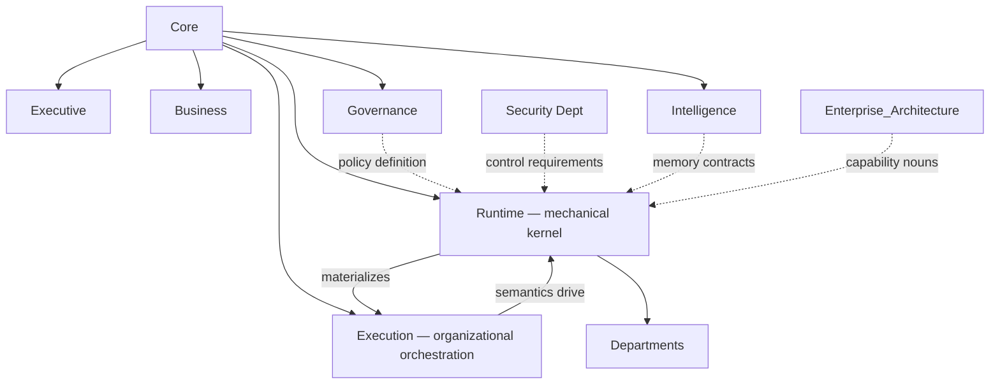

# Runtime Platform Charter

> Runtime is the **mechanical kernel** of Umer AI OS — the substrate that executes work across Departments while respecting every ownership boundary already ratified. It coordinates machinery. It does **not** own business decisions, engineering delivery, governance policy *definition*, or organizational memory *content*.

Ratified via `RFC/Records/RFC-002-runtime-platform.md`. Governed by `Core/AI_OS_CONSTITUTION.md`. Organizational orchestration semantics remain owned by `Execution/`.

## Why Runtime Exists Separately From Execution

`Execution/` answers: *what is a request, a workflow instance, a gate, a handoff, a context package, a recovery decision — in organizational terms.*

`Runtime/` answers: *how does the machine reliably invoke Agents, route models, enforce permissions, carry state, emit events, checkpoint, retry, audit, and isolate tools — for ten years of model and infra change.*

Collapsing them produces either an unimplementable policy document or a kernel that starts making business decisions. Splitting them is the Kubernetes-style separation: API/semantics vs control-plane/data-plane machinery — applied to an AI organization.

## Mission

> Provide a durable, auditable, multi-tenant-capable execution substrate that materializes Execution instances, Agent work, tool calls, and human approvals into observable, recoverable, policy-bound runs — without ever becoming the owner of intent, delivery quality, or organizational learning content.

## Position in the Enterprise Model



## What Runtime Owns

| Domain class | Meaning |
|---|---|
| Kernel invariants | Boot, tenancy isolation baselines, hard safety stops |
| Invocation machinery | Agent/tool/model invocation, sandboxes, sessions |
| Mechanical orchestration | Schedulers, task graphs, checkpoints, retries implementing Execution |
| Enforcement points | Policy PEP, approval waits, identity/permission checks |
| Platform buses | Command/query and event fabrics |
| Runtime state | Run/instance/session mechanical state (not Business intent) |
| Platform observability & audit streams | Kernel health + immutable audit events |
| Extension points | Plugins and external integration adapters |
| Resource/economy controls | Quotas, cost envelopes, allocation |

## What Runtime Explicitly Does Not Own

| Temptation | Actual owner |
|---|---|
| What to build / invest | `Business/` |
| Delegation, staffing intent, CEO planning judgment | `Executive/` |
| Request meaning, workflow stage meaning, gate *policy*, handoff *protocol* | `Execution/` |
| Org-wide policies, RACI, risk appetite | `Governance/` |
| Knowledge content, research libraries, lessons | `Intelligence/` |
| Capability/Domain taxonomy | `Enterprise_Architecture/` |
| Software implementation, product SLOs | `Departments/Engineering` |
| UX / Design System | `Departments/Design` |
| Independent QA authority | `Departments/QA` |
| Security control design | `Departments/Security` |
| Business measurement definitions | `Departments/Analytics` / Business |
| Agent role *specifications* | `Core/AGENT_SPECIFICATION.md` (future Agent instances) |
| Department structure | `Departments/DEPARTMENT_ARCHITECTURE_STANDARD.md` |

## Governing Rules

1. **Runtime never invents intent.** It only runs what Execution (and authorized Human/Executive signals) admit.  
2. **Runtime never waives Governance or Security.** It enforces; it does not redefine policy or controls.  
3. **Runtime never stores the system of record for organizational knowledge.** It accesses Intelligence under contract.  
4. **Models are dependencies, not foundations** (`Core/AI_OS_CONSTITUTION.md` §4) — Model Routing must allow substitution without redesigning Departments.  
5. **Human accountability remains non-delegable** — Human Collaboration Runtime exists to *implement* Constitution §5 waits, not to automate them away.  
6. **Structural changes to this Charter go through `RFC/RFC_PROCESS.md`.**

## Metadata

```yaml
version: 1.0.0
status: active
last_reviewed: 2026-07-22
owner: Chief of Staff (stewardship), CEO (ratification), Chief Platform Architect (design authority)
```
